# SRMS 유지보수 인수인계 문서

VS Code, GitHub Copilot, 그 밖의 AI 도구 또는 새 개발자가 이 코드를 이어서 고치거나 확장할 때 가장 먼저 읽는 문서입니다. 기준일은 2026-11-11이며 마일스톤 M1~M7은 모두 승인되었고 작업일지·SR 분할·월간 현황표·표 가독성 개선까지 반영되어 있습니다.

| 문서 | 용도 |
|---|---|
| [요구사항.md](../요구사항.md) | 원 요구사항(팀장 원문) |
| [설계서.md](../설계서.md) | 설계 기준(데이터 모델, 프로세스 엔진, 메일, 리포트, 보안) |
| [개발관리.md](../개발관리.md) | 진행 이력, 결정/변경 이력(7장), 검증 기록(6장) |
| [docs/설치운영가이드.md](설치운영가이드.md) | 서버 설치, `.env`, 백업, 복원, 점검표 |
| [docs/신규회사설치가이드.md](신규회사설치가이드.md) | 다른 회사에 처음 설치하거나 회사를 추가하는 절차 |
| [docs/사용자매뉴얼.md](사용자매뉴얼.md) | 롤별 사용 방법 |
| docs/ppt/*.pptx | 롤별 사용자 매뉴얼 PowerPoint 4종(사용자매뉴얼.md 기반, 화면 캡처 포함). 매뉴얼이나 화면이 바뀔 때 `docs/ppt/screens/` 캡처를 다시 찍고 `python tools/make_manual_ppt.py` 로 다시 만듭니다(개발 도구 의존: `pip install python-pptx`, 문구는 `tools/manual_ppt_content.py`). 캡처는 데모 서버(`bin/demo.php --db=... --reset` 후 `tools\serve.ps1`)를 띄우고 `node tools/capture_screens.mjs <출력폴더> tools/capture_jobs.json` 로 찍습니다(Edge headless + 로그인 세션을 붙이는 로컬 프록시, 네비게이션 바 없이 데스크톱 폭으로 캡처). 결과 PNG 는 오른쪽·아래 흰 여백을 잘라 낸 뒤 덮어씁니다(크롭 좌표는 원본 픽셀 기준). |
| [docs/테스트시나리오.md](테스트시나리오.md) | 롤별 검증(인수) 시나리오 |
| [docs/THIRD_PARTY.md](THIRD_PARTY.md) | 번들 라이브러리와 라이선스 |

## 1. 작업을 시작하기 전에

1. [개발관리.md](../개발관리.md)의 5장(현재 상태)과 7장(결정/변경 이력)을 읽습니다. 설계서와 다르게 구현해야 하면 임의로 바꾸지 말고 7장에 기록하고 설계서도 고칩니다.
2. 기준선을 확인합니다. 지금은 테스트 214건이 모두 통과하고 문법 검사 128개 파일에 오류가 없어야 합니다.
3. 작업 후에는 아래 §8의 게이트를 다시 실행하고 [개발관리.md](../개발관리.md)를 갱신합니다.

### AI 도구에 줄 시작 프롬프트(권장)

```
c:\dev\srms 는 PHP 8.5 + SQLite 로 만든 SRMS(시스템 유지보수 요청 관리)입니다.
docs/유지보수인수인계.md 와 개발관리.md 를 먼저 읽고, §5 의 코딩 규칙을 지켜 주세요.
변경 후 tests\run.php 와 tools\check.ps1 를 실행해 통과를 확인하고, 설계와 달라지는 결정은 개발관리.md 7장에 기록하세요.
```

## 2. 기술 스택과 제약

| 항목 | 내용 |
|---|---|
| 언어/런타임 | PHP 8.5.x(검증은 8.5.12 NTS). 프레임워크 없는 자체 경량 MVC, Composer 미사용 |
| DB | SQLite 3.35+(WAL, `busy_timeout=5000`). 외부 DB 서버 없음 |
| 화면 | Bootstrap 5.3.8, Bootstrap Icons, Quill 2.x(에디터), SortableJS(단계 정렬), Chart.js 4.6.1. 모두 `public/assets/vendor` 로컬 번들. **CDN 금지** |
| 메일 | PHPMailer 7.2.0(`vendor/`), 전송 방식 `smtp` / `file` / `off` |
| 웹서버 | Apache 또는 Nginx. `.htaccess` 에 의존하지 않고 `public/index.php` 단일 진입 |
| 언어 | ko(기본), ja, en, zh |
| 개발 PC | 시스템 PHP 가 없어 `.tools\php\php.exe` 휴대용 PHP 를 사용(`.gitignore` 로 제외, 저장소에 없음) |

개발 PC에 `.tools\php` 가 없으면 PHP 8.5 NTS x64 를 받아 `.tools\php` 에 풀고, `php.ini` 에서 `pdo_sqlite`, `sqlite3`, `mbstring`, `fileinfo`, `openssl`, `intl` 를 켭니다. 시스템에 PHP 가 있으면 `php` 로 바꿔 실행해도 됩니다.

## 3. 폴더 구조

```
public/            웹루트. index.php(프론트 컨트롤러), assets/{css,js,vendor}
app/
  bootstrap.php    오토로더(App\ → app/), Env 로드, 시간대
  helpers.php      e(), t(), url(), asset(), can(), csrf_field(), theme(), fmt_date() 등 뷰 헬퍼
  routes.php       모든 라우트 + 필요 권한(perm) 선언
  Core/            Router, Db, Repo, Scope, Auth, Session, Csrf, I18n, View, Request, Response, Migrator, Audit, Env, HttpException, Controller
  Controllers/     화면별 컨트롤러(얇게 유지, 업무 규칙은 Services)
  Services/        업무 규칙(엔진, 요청, 일정, 메일, 대시보드, 리포트, 시드, 백업, 점검 등)
  Services/Mail/   메일 전송 계층(smtp/file/memory)
  Auth/            AuthProviderInterface, SsoAuthProvider(미연동), Providers
  Views/           PHP 템플릿(layouts, home, requests, logs, admin, reports, profile, auth, errors)
  lang/            ko.php ja.php en.php zh.php (화면 문구)
database/migrations/  001~011 .sql (스키마, 파일명 순 적용)
bin/               install, company, migrate, cron, backup, doctor, mailtest, demo
tools/             check.ps1(문법검사), serve.ps1(개발 서버), demo.ps1(데모 환경)
deploy/            Apache/Nginx/php.ini/스케줄러 샘플
storage/           db, attachments, logs, backup, mail (웹루트 밖, 데이터는 git 제외)
tests/             run.php(자체 러너) + cases/01~17
vendor/phpmailer/  번들 라이브러리
docs/              운영·인수인계 문서
```

## 4. 구조와 요청 흐름

```mermaid
flowchart LR
  B[브라우저] --> I[public/index.php]
  I --> R[Router: 세션·CSRF·권한 확인]
  R --> C[Controller]
  C --> S[Services: 업무 규칙]
  S --> P[Repo / Db: company_cd 강제]
  P --> D[(SQLite)]
  S --> N[Notifier → notification_log 큐]
  N --> M[MailService → smtp/file]
  C --> V[View + lang t&#40;&#41;]
```



- 라우터([app/routes.php](../app/routes.php))가 로그인 여부와 `perm` 옵션(권한 코드)을 일괄 검사합니다. 공개 경로는 `['public' => true]` 로 표시합니다. 모든 POST는 CSRF 토큰이 필요합니다.
- 컨트롤러는 입력 검증과 화면 흐름만 맡고, 상태 전이와 업무 규칙은 `Services` 에 둡니다.
- 메일은 상태 변경과 같은 트랜잭션에서 `notification_log` 에 적재되고, 응답이 끝난 뒤 즉시 발송을 시도합니다. 실패분은 `bin/cron.php` 가 재시도합니다.

### 핵심 서비스

| 파일 | 역할 |
|---|---|
| `WorkflowService` | 제출, 처리(승인/합의/검수/종료), 반려, 취소. 단계 활성화와 회차(round) 관리. 모든 전이는 하나의 트랜잭션 |
| `RequestService` | 요청 저장(임시저장/보완), 목록·상세 조회, 채번(`SR-YYYYMM-NNNN`), 댓글, 투입시간 |
| `WorklogService` | 작업일지(사후등록) 등록·수정·삭제, 유형·채널 코드·시스템 기본 프로세스 자동 생성(`ensure`), 기존 회사의 작업완료 처리자 보강(`upgradeProcess`). `request.reg_by` 가 있으면 작업일지 |
| `SplitService` | IT 담당자 지정(`it_assignee_id`)과 SR 분할(`parent_id`). 이력은 감사로그로만 남김 |
| `Users`, `Dates` | 사용자 생성·프로필 검증·롤 설정, 영업일 계산·지연일수 |
| `Effort` | 투입시간 입력 검증(0~9999.99, 소수 둘째 자리)과 표시 형식. 투입시간은 `request.effort_hours`(시간) 하나로만 저장·집계하고 MD 환산은 하지 않습니다(마이그레이션 011). 입력 화면은 `effort_input()` 헬퍼 |
| `RequestAccess` | 열람·처리함·참조 범위를 SQL 조건으로 생성(본인/주관부서/전체/처리자/참조자) |
| `ActorResolver` | 단계의 처리자 유형(롤/지정자/요청자/서비스 전산담당/서비스 현업 IT 담당자/서비스 주관부서)을 사용자로 해석 |
| `ProcessService` | 프로세스 마스터·버전·단계·참조자·매핑, 유효기간 겹침 검증, 활성화 검증, 적용 버전 결정 |
| `ScheduleService` | 일정 변경 제안/합의/반려/대안/철회 |
| `Notifier`, `MailService`, `MailTemplates` | 수신자 결정, 큐 적재, 발송/재시도, 템플릿 시드와 렌더링 |
| `Reminders` | 기한 임박/초과 독촉, 일정 회신 독촉(`bin/cron.php` 에서 호출) |
| `DashboardService`, `ReportService` | 롤별 대시보드, 리포트 집계와 CSV |
| `AttachmentService` | 첨부 정책, 저장(웹루트 밖 난수 이름), 다운로드 |
| `HtmlSanitizer` | 에디터 HTML 화이트리스트 정리(저장 시 + 출력 시) |
| `Seeder`, `CompanySetup`, `Translations` | 회사 생성과 기본 데이터(롤/권한/코드/프로세스/메일/번역) |
| `Backup`, `Doctor` | 백업 스냅샷, 설치 점검 |

## 5. 반드시 지킬 코딩 규칙

1. **모든 테이블 첫 컬럼은 `company_cd`.** DB 접근은 `Repo`(회사코드 자동 부가) 또는 `Db` 를 통해서만 합니다. 직접 쿼리를 쓸 때는 `WHERE company_cd = :company_cd` 를 빠뜨리지 않습니다. 회사는 로그인 시 세션에 고정되며 폼/URL 의 회사값은 신뢰하지 않습니다. 타 회사 ID 는 404 처리합니다.
2. **SQL 은 항상 바인딩.** 문자열 결합 금지. 테이블·컬럼명처럼 바인딩할 수 없는 식별자는 화이트리스트로 검사합니다. `Db` 는 값의 PHP 타입으로 바인딩합니다(정수는 INTEGER). 문자열 `'1'` 을 넘기면 `:flag = 1` 조건이 거짓이 될 수 있으니 정수를 넘깁니다.
3. **출력은 `e()`**, 문구는 `t('키')`. 화면에 문구를 하드코딩하지 않습니다. 새 문구는 ko/ja/en/zh 4개 파일에 같은 키와 같은 `{치환자}` 로 추가합니다(테스트 04 가 누락·불일치를 검사).
4. **POST 는 `csrf_field()`** 를 포함합니다. AJAX 는 `X-CSRF-Token` 헤더를 씁니다.
5. **인라인 스크립트/핸들러 금지**(CSP `default-src 'self'`). 확인창은 `data-confirm` 속성 + [public/assets/js/app.js](../public/assets/js/app.js), 화면별 동작은 별도 js 파일에 둡니다. 사용자 선택 목록은 `user_options()` 헬퍼(부서별 묶음)로 그리고 `<select data-filter data-filter-ph="..." data-filter-empty="...">` 를 붙이면 app.js 가 검색 입력칸을 자동으로 추가합니다. 차트 데이터는 `data-chart` JSON 으로 넘깁니다.
6. **외부 CDN/웹폰트 금지.** 라이브러리는 `public/assets/vendor` 에 두고 [docs/THIRD_PARTY.md](THIRD_PARTY.md) 를 갱신합니다(자동 테스트가 화면·스크립트·스타일의 외부 URL 을 검사).
7. 이력 테이블(`approval`, `schedule_change`, `schedule_agreement`, `audit_log`)은 INSERT 전용입니다. 마스터와 사용자는 삭제 대신 `use_yn` 으로 비활성화합니다. 요청은 삭제하지 않고 `CANCELED` 로 둡니다.
8. 상태·타입·단계 코드값은 고정 영문 코드로 저장하고 표시만 번역합니다. 사용자가 입력한 내용(제목, 본문, 의견, 사유)은 번역하지 않습니다.
9. 날짜는 DB 에 ISO(`YYYY-MM-DD`, 시각은 `now_str()`)로 저장하고 `fmt_date()` 로 표시합니다. 영업일 계산은 `Dates` 를 사용합니다.
10. 권한 확인은 화면 버튼 숨김만으로 끝내지 않고 라우트 `perm` 과 서비스 계층에서 서버 검증합니다.
11. 오류는 `ProcessError('lang.key')` 처럼 번역 키로 던지고 컨트롤러가 번역해 보여 줍니다. 운영에서는 오류 상세를 노출하지 않습니다.
12. 테스트에서만 Argon2 비용을 낮추는 `ARGON_MEMORY_KB`/`ARGON_TIME` 이 있습니다. 운영 기본값은 PHP 기본값입니다.

## 6. 핵심 업무 규칙(요약)

상세는 [설계서.md](../설계서.md) 6, 9, 10장을 따릅니다. 코드를 고칠 때 깨뜨리기 쉬운 규칙만 모았습니다.

### 6.1 롤과 권한

| 롤 | 권한 |
|---|---|
| `REQUESTER` 현업 사용자 | `REQUEST_CREATE`, `REQUEST_VIEW_OWN`, `REQUEST_VIEW_CC`, `STEP_ACT`, `SCHEDULE_PROPOSE` |
| `BIZ_IT` 현업 전산담당 | 위 + `REQUEST_VIEW_DEPT`, `REPORT_VIEW` |
| `IT_TEAM` 전산팀 | 위 + `REQUEST_VIEW_ALL`, `WORKLOG_REG`(작업일지 사후등록·관리), `REQUEST_SPLIT`(요청 분할·IT 담당자 지정) |
| `SYS_ADMIN` 시스템관리자 | 전체(롤 화면에서 변경 불가) |

- 한 사용자가 여러 롤을 가질 수 있습니다. 롤-권한 매핑은 회사별로 `관리 > 롤/권한` 에서 바꿉니다.
- 관리 메뉴 권한: 사용자·부서·롤 = `USER_EDIT`, 공통코드 = `CODE_EDIT`, 서비스 = `SERVICE_EDIT`, 프로세스·매핑·메일 템플릿·메일 이력 = `PROCESS_EDIT`, 작업일지 메뉴·등록 = `WORKLOG_REG`.
- 대시보드 위젯은 롤 이름이 아니라 권한으로 결정합니다(`REQUEST_VIEW_DEPT`, `REQUEST_VIEW_ALL`).
- 처리자 유형 `SERVICE_IT_OWNER` 는 **요청별 담당자(`request.it_assignee_id`)가 있으면 그 사람, 없으면 서비스 전산 담당자**입니다(`ActorResolver`, `RequestAccess::actorExpr`·`ccExpr` 의 `COALESCE`). 처리자 판정을 고칠 때 이 두 곳을 함께 바꿔야 합니다. 담당자 지정·SR 분할은 `SplitService` 이며, 이력은 `approval` 이 아니라 감사로그(`REQUEST_ASSIGN`)와 `parent_id` 로 남깁니다(`approval` 에 넣으면 처리함·복수 승인 판정에 영향).

### 6.2 요청 상태와 단계 처리

- 상태: `DRAFT` → `IN_PROGRESS` → `COMPLETED`, 그리고 `RETURNED`(보완요청), `CANCELED`.
- 제출 시 적용 프로세스 버전이 요청에 **고정**되고 단계가 스냅샷(`request_step`)으로 만들어집니다. 이후 프로세스를 개정해도 진행 중인 건은 접수 시점 버전을 따릅니다.
- 처리 결정은 `PASS`(승인/합의/검수/종료/작업 완료) 또는 `REJECT`(사유 필수). 승인 방식 `ANY`(1명 처리 시 완료) / `ALL`(전원 처리 시 완료).
- 반려는 단계의 `reject_to_step` 으로 되돌립니다. 값이 없거나 1단계이면 요청자에게 `RETURNED` 로 반환됩니다. 같은 단계를 다시 거치면 회차(`round`)가 올라가고 처리 여부는 회차 단위로 계산합니다.
- 첨부가 `REQUIRED` 인 단계는 첨부가 없으면 `PASS` 가 거부됩니다.
- 요청자만 취소할 수 있습니다(임시저장/진행중/보완요청). 취소 시 진행 중인 일정 협의는 철회됩니다.
- 처리자 판정은 `ActorResolver`(처리 시)와 `RequestAccess::actorExpr`(목록 SQL)에 이중으로 구현되어 있습니다. **처리자 유형을 추가하거나 의미를 바꾸면 두 곳과 `ccExpr`(참조자)을 함께 고칩니다.**
- `SERVICE_BIZ_DEPT` = 서비스 주관부서에 소속되고 `BIZ_IT` 롤을 가진 활성 사용자입니다.
- `SERVICE_BIZ_OWNER`(기본 프로세스의 승인·사후합의) = `service_biz_it` 에 지정된 사용자 중 **자격이 있는 사람**(활성 + `BIZ_IT` 롤 + 서비스 주관부서 소속)입니다. 자격 있는 지정자가 한 명도 없으면(미지정 포함) `SERVICE_BIZ_DEPT` 규칙으로 폴백합니다. 판정은 `ActorResolver::eligibleBizOwners`/`bizOwnerIds` 와 `RequestAccess::bizOwnerCond`(SQL) 두 곳에 같은 규칙으로 있습니다(테스트 18 이 PHP/SQL 일치를 검증). 지정은 서비스 저장 화면(`ServiceController`)에서 같은 조건을 서버가 검증하고 서비스 저장과 함께 한 트랜잭션으로 갱신합니다. 지정 후에 사용자가 비활성·롤 상실·부서 이동을 해도 행은 남아 있지만 판정에서 제외되며, 서비스 목록의 `지정자 확인 필요` 배지와 `bin/doctor.php`(`현업 IT 담당자` 항목)가 이를 알립니다.

### 6.3 프로세스 버전

- 활성 버전은 수정할 수 없고, 새 버전(초안)을 만들어 편집한 뒤 활성화합니다.
- 같은 프로세스에서 유효기간이 겹치는 `ACTIVE` 버전은 둘 수 없습니다. 종료일이 없는 새 버전은 앞선 활성 버전을 시작일 전날로 자동 종료하고, 사용 이력이 없거나 오늘 이후 시작인 겹치는 버전은 대체합니다. 종료일이 있는 새 버전은 겹치면 오류입니다.
- 사용 이력이 있는 버전과 매핑된 프로세스는 삭제할 수 없습니다.
- 기본 프로세스는 `GENERAL`(접수→검토→승인→수행→검수→종료, 승인은 `SERVICE_BIZ_OWNER`)과 `URGENT`(접수→승인→수행→사후합의→종료)입니다. 회사 생성 시 `Seeder` 가 만듭니다. 시드를 바꿔도 이미 존재하는 회사에는 영향이 없으므로(`ensureDefaults` 는 이미 시드한 프로세스를 다시 만들지 않음) 기존 회사는 관리 화면에서 새 버전을 만들어 바꿉니다. 예외로 승인·사후합의의 `SERVICE_BIZ_DEPT`→`SERVICE_BIZ_OWNER` 전환은 `bin/migrate.php`(`Seeder::ensureDefaults`)가 기존 회사의 `GENERAL`·`URGENT` 모든 버전에 한 번(`app_setting` `seed.biz_owner_actor`) 직접 적용합니다(지정이 없으면 폴백으로 동작이 같아 활성 버전도 제자리에서 갱신하며, 관리자가 만든 프로세스는 건드리지 않음).
- 엔진 테스트(06~12)는 단계 번호가 고정된 옛 7단계 구조를 전제로 하므로 `rw()` 가 `legacy_general_7()` 로 기본 시드를 7단계로 되돌립니다. 기본 시드(6단계) 자체는 05 시드 테스트와 06 의 `rw(false)` 테스트가 검증합니다.
- **시스템 기본 프로세스**: 작업일지가 쓰는 `WORKLOG` 프로세스(접수→작업완료)는 `ProcessService::isSystem()` 으로 판정하며 버전 생성·날짜 변경·활성화·종료·단계/참조자 변경·삭제를 서비스에서 `process.err_system` 으로 거부합니다(이름·설명 번역과 초안 버전 삭제만 예외). 작업완료 단계 처리자는 `SERVICE_IT_OWNER`(작업일지는 등록자) 이고, 접수 단계는 엔진 규칙(`SUBMIT` 처리자=요청자) 때문에 `REQUESTER` 입니다. 이미 만들어진 회사는 `bin/migrate.php` 가 한 번(`app_setting` `seed.worklog_actor`) 단계 정의를 직접 수정합니다. 작업일지는 병목 리포트에서 제외됩니다(`r.reg_by IS NULL`).

### 6.4 일정 변경(완료요구일 협의)

- 프로세스가 아니라 **요청 단위 기능**입니다. 완료요구일(`req_due_date`)은 모든 요청에 필수이며 DB 트리거와 서비스 계층이 함께 강제합니다.
- 제안은 현재 단계 처리자(작업자)만, 합의/반려/대안은 요청자 본인만 합니다. 요청당 협의 중(`PROPOSED`)은 1건만 허용(부분 유니크 인덱스).
- 협의 중에는 그 요청의 단계 처리가 막힙니다(`request.err_schedule_locked`).
- 합의 시에만 `plan_end` 가 바뀌고, 반려/대안이면 기존 일정이 유지됩니다. 제안 날짜는 현재 유효 목표일(`plan_end` ?? `req_due_date`)보다 늦어야 하고, 대안은 오늘 이후이면서 제안일보다 앞서야 합니다.
- 방치해도 자동 조치는 없고 리포트의 지연 실적으로만 관리됩니다.

### 6.5 메일

- 피드백이 필요한 사람에게만 보냅니다: 단계 활성화 → 처리자, 반려/보완 → 재처리자, 일정 제안 → 요청자, 일정 반려/대안 → 작업자. 합의는 메일이 없습니다. 본인이 방금 한 행위는 제외, 같은 이벤트·수신자는 `dedupe_key` 로 중복 적재하지 않습니다.
- 참조자(CC)는 단계별 옵션 `NONE/ACTIVATE/COMPLETE/BOTH` 에 따라 참조용 템플릿으로 받고, 처리자와 겹치면 처리자 메일 한 통만 갑니다.
- 재시도는 5/15/60/240분 후 최대 5회, 이후 `FAILED`(관리 화면에서 다시 보내기). 발송 중 행은 `SENDING` + 임대 시각으로 웹/크론 중복 발송을 막습니다.
- 본문은 text/plain, 변수 치환은 단일 패스이고 제목의 개행은 제거합니다. 템플릿 코드: `STEP_ACTIVE`, `STEP_RETURNED`, `STEP_CC_ACTIVATED`, `STEP_CC_COMPLETED`, `SCHEDULE_PROPOSED`, `SCHEDULE_REJECTED`, `SCHEDULE_COUNTERED`, `DUE_SOON`, `DUE_OVER`, `SCHEDULE_REMIND`, `SR_SPLIT`. 수신자의 언어 템플릿으로 발송하고 없으면 ko 로 대체합니다.
- `MAIL_DRIVER` 미지정 시: `SMTP_HOST` 가 있으면 smtp, 없으면 개발은 file, 운영(`APP_ENV=production`)은 off(대기열에만 보관).

### 6.6 리포트와 대시보드

- 리포트 화면(`Views/reports/index.php`)은 `tab=monthly|detail`(서버 렌더링 탭)로 나뉩니다. 탭에 맞는 입력만 보여 주고 다른 탭 값은 hidden 입력으로 유지합니다. 새 정의 문구는 `rpt.def.*` 키(4개 언어)로 추가합니다.
- 표 스타일 규약(`public/assets/css/app.css`): 목록·관리·리포트 표는 `<table class="table table-sm … tbl-grid">` 를 씁니다(세로선, 가운데 정렬 헤더, 배경색 헤더). 보조 클래스: `.tbl-scroll`(감싸는 div 에 붙이면 헤더 고정 스크롤), `.tbl-title`(제목 말줄임; `title` 속성으로 전체 제목), `tr.row-late`(빨간 배경: 지연 건, 메일 실패 건), `tr.row-inactive`(미사용 흐림), `tr.tbl-group`(그룹 구분 행). 마지막 작업 열 제목은 `common.manage`. 리포트 전용은 `.rpt-grid`(줄바꿈 금지), `.rpt-c1`/`.rpt-c2`(앞 두 열 고정), `.rpt-grp-start`·`.rpt-alt`(그룹 구분), `.rpt-sum`·`.rpt-key`·`.rpt-lead`(강조). 숫자 열은 `text-end`, 상태·날짜·버튼은 `text-center`. `bg-light`/`text-dark`/`table-light` 같은 고정 색 클래스는 다크 테마에서 깨지므로 쓰지 않습니다(`tests/cases/15_theme.php` 가 검사하며 `text-bg-<?= … 'dark' ?>` 처럼 뒤에 붙는 동적 클래스도 걸립니다). 색은 `var(--bs-…)` 변수나 `*-subtle` 계열을 씁니다.
- 리포트 표 렌더링은 뷰 안에서 헤더 이름(`rpt.col.late` 등)으로 지연 열을, 지표 행 이름(`rpt.m.in` 등)으로 강조 행을 판별합니다. 열·지표 이름을 바꾸거나 새 지연 열을 추가할 때는 `Views/reports/index.php` 맨 위의 `$lateHeads`, `$sumHeads`, `$keyMetrics`, `$lateMetrics` 목록도 함께 고칩니다. 롤/권한 표의 권한 그룹(`role.grp.*`)은 `Views/admin/roles/index.php` 의 `$groupOf` 가 권한 코드 접두어로 정하므로 새 권한 코드를 추가하면 그룹을 확인하세요(없으면 `기타`).
- 월간 현황표(`ReportService::monthly`): 연도 1~12월 × (SR/작업일지/전체). **SR 블록만 전체 지표(이월·완료·취소·진행·기한 초과·지연·완료율·평균 처리일수·투입시간)를 두고, 작업일지·전체 블록은 접수와 투입시간 두 행만** 출력합니다(작업일지는 저장 즉시 정시 완료라 SR 수준 지표를 왜곡하지 않도록). 위쪽 차트는 SR 접수·완료입니다. 접수=요청일, 완료=`actual_end`, 취소=`canceled_at`(마이그레이션 010, 취소 처리 시 `WorkflowService::cancel` 이 기록)이 속한 달. 접수에 취소 건을 포함하고 제출한 적 없는 취소 건은 빼며(요청일 NULL), 이월+접수-완료-취소=진행(기말)=다음 달 이월 항등식을 `12_report` 테스트가 SR 블록에서 검증합니다. 스냅샷 없이 현재 데이터로 계산하고, 기한 초과는 말일(이번 달은 오늘) 기준입니다. 지표를 추가할 때는 언어 키(`rpt.m.*`, `rpt.col.*`)를 4개 언어에 함께 추가하세요.
- 기간은 요청일(`request_date`: 일반 SR 은 최초 제출일, 작업일지는 입력한 요청일, 재제출 시 불변, 분할 SR 은 원본 상속; 마이그레이션 009 가 기존 제출 건을 채움) 기준이며 임시저장·취소 건은 제외합니다. 담당자는 `it_assignee_id`, 없으면 서비스 전산 담당자입니다.
- 데이터 범위: `REQUEST_VIEW_ALL` → 전체, `REQUEST_VIEW_DEPT` → 주관부서 서비스만, 그 외 → 빈 결과.
- 지연: 진행/보완 중 건의 유효 완료일(`plan_end` 우선, 없으면 `req_due_date`)이 오늘 이전. 임박: 오늘~3일 이내.
- CSV 는 UTF-8 BOM 이며 `= + - @` 로 시작하는 셀은 `'` 를 붙여 수식 주입을 막습니다(`-` 단독은 예외).

## 7. 데이터베이스와 마이그레이션

- 스키마는 [database/migrations](../database/migrations) 의 `NNN_이름.sql` 을 파일명 순으로 적용하고 `schema_migration` 에 기록합니다(`bin/migrate.php`, 여러 번 실행해도 안전).
- 이력: 001 전체 스키마, 002 일정조율 시드 제거, 003 회차(round)·완료요구일 트리거, 004 일정 합의 단순화, 005 메일 큐 컬럼, 006 사용자 테마, 007 작업일지(`request_date`, `channel`, `reg_by`), 008 SR 분할(`parent_id`, `split_by`; 요청별 담당자 `it_assignee_id` 는 001 에 있던 컬럼), 009 요청일을 최초 제출일로 채움, 010 취소일(`canceled_at`), 011 투입시간(`effort_md` 제거, `effort_hours` 추가).
- **이미 적용된 마이그레이션 파일은 수정하지 않습니다.** 변경은 `012_...sql` 처럼 새 파일로 추가합니다. SQLite 는 컬럼 변경에 제약이 있어, 제약이 필요하면 트리거를 쓰거나 테이블을 재생성합니다.
- 기본 데이터(권한, 롤, 코드, 프로세스, 메일 템플릿, 번역)는 SQL 이 아니라 PHP([app/Services/Seeder.php](../app/Services/Seeder.php), `MailTemplates`)가 회사별로 시드합니다. `bin/migrate.php` 는 모든 회사에 `Seeder::ensureDefaults` 를 호출해 빠진 기본값을 채웁니다.

## 8. 개발·검증 명령

PowerShell, 저장소 루트(`c:\dev\srms`)에서 실행합니다.

| 목적 | 명령 |
|---|---|
| 전체 테스트 | `.\.tools\php\php.exe -c .tools\php\php.ini tests\run.php` |
| 이름 필터 | `.\.tools\php\php.exe -c .tools\php\php.ini tests\run.php schedule` |
| 문법 검사 | `powershell -File tools\check.ps1` |
| 개발 DB 생성 | `$env:DB_PATH='storage/db/dev.sqlite'; .\.tools\php\php.exe -c .tools\php\php.ini bin\install.php --company=HQ --company-name=본사 --admin=admin --admin-name=관리자 --admin-email=a@x.com --password=Admin1234` |
| 개발 서버 | `$env:DB_PATH='storage/db/dev.sqlite'; $env:MAIL_DRIVER='file'; powershell -File tools\serve.ps1` → http://127.0.0.1:8080 |
| 데모 환경 | `powershell -File tools\demo.ps1`(데모 DB 를 새로 만들고 서버 시작, 모든 계정 비밀번호 `Demo1234`) |
| 주기 작업 | `.\.tools\php\php.exe -c .tools\php\php.ini bin\cron.php` |
| 점검/백업/메일 | `bin\doctor.php`, `bin\backup.php`, `bin\mailtest.php 받는사람@회사.com` |

### 검증 게이트(변경 후 매번)

| # | 항목 | 방법 |
|---|---|---|
| G1 | 문법 | `tools\check.ps1` 오류 0 |
| G2 | 자동 테스트 | `tests\run.php` 전체 통과 |
| G3 | 회사 격리 | 새 기능이 두 회사 데이터를 섞지 않는지 테스트 추가 |
| G4 | 보안 | 바인딩, 이스케이프, CSRF, 권한, 업로드 검증 |
| G5 | 다국어 | 새 문구가 4개 언어 파일에 있는지(테스트 04) |
| G6 | 수동 확인 | 개발 서버에서 화면 확인(UI 변경 시) |
| G7 | 문서 | [개발관리.md](../개발관리.md) 갱신, 설계 변경 시 [설계서.md](../설계서.md) 반영 |

### 테스트 구조

- [tests/run.php](../tests/run.php) 는 외부 의존이 없는 자체 러너입니다. 케이스는 `tests/cases/NN_이름.php`(01 DB, 02 인증, 03 HTTP, 04 다국어, 05 프로세스, 06 요청, 07 첨부, 08 일정, 09 메일, 10 메일 관리, 11 대시보드, 12 리포트, 13 인증 확장, 14 운영도구, 15 테마, 16 작업일지, 17 SR 분할)이고 `test('이름', fn)` 으로 작성합니다.
- 헬퍼: `fresh()`(메모리 DB 초기화), `seed_two_companies()`(A01/B01 두 회사), `http()`(요청 주기 흉내), `login()`, `last_flash()`, `body_has()`, `ok()`, `eq()`, `throws()`.
- 새 기능은 해당 번호의 파일에 테스트를 추가하고, 회사 격리와 권한 거부(403/404) 케이스를 함께 넣습니다.

### 작업 시 주의(과거에 겪은 함정)

- PowerShell 에서 `$home` 은 읽기 전용 변수입니다. 스크립트 변수 이름으로 쓰지 않습니다.
- PHP 내장 `getopt` 는 위치 인자 뒤의 옵션을 읽지 못합니다(`bin/company.php` 가 직접 파싱).
- 폼을 다시 그리는 응답은 레이아웃이 플래시 메시지를 소비합니다. 테스트에서는 `last_flash()` 대신 본문 검사(`body_has()`)를 씁니다.
- 셸에 남은 `SINGLE_COMPANY`, `STORAGE_PATH`, `MAIL_DRIVER` 가 테스트에 영향을 주지 않도록 러너가 고정합니다. 개발 서버를 띄울 때는 이전 서버가 8080 포트를 점유 중인지 확인합니다(`Get-CimInstance Win32_Process -Filter "Name='php.exe'"`).
- 이 개발 PC 의 백신이 위험 내용(HTML 스크립트, PHP 코드, MZ 헤더)이 든 임시 파일 읽기를 막을 수 있어, 해당 첨부 테스트는 `err_type` 또는 `err_upload` 중 하나로 거부되면 통과로 판정합니다.
- 설정은 `.env` 값이 먼저이고, 없으면 프로세스 환경변수를 씁니다(`Env::get`).

## 9. 자주 하는 변경 절차

### 9.1 새 화면(기능) 추가
1. [app/routes.php](../app/routes.php) 에 경로와 `perm` 을 추가합니다.
2. `Controllers/` 에 액션, `Services/` 에 업무 규칙, `Views/` 에 템플릿을 만듭니다.
3. 메뉴가 필요하면 [app/Views/layouts/main.php](../app/Views/layouts/main.php) 에 `can()` 분기로 추가합니다.
4. 문구는 4개 lang 파일에 추가하고 테스트(권한, 회사 격리, CSRF, 이스케이프)를 씁니다.

### 9.2 새 권한 추가
1. `Seeder::PERMISSIONS` 에 코드와 한국어 명칭을 추가하고 4개 lang 파일에 `perm.코드` 를 추가합니다.
2. 기본 롤에 줄 권한은 `Seeder::ROLES` 에 적습니다. 신규 회사에만 적용되며, **이미 있는 회사에는 `bin/migrate.php` 가 권한 코드만 추가하고 롤 매핑은 하지 않으므로** 관리자가 `관리 > 롤/권한` 에서 직접 켜거나, 필요하면 `ensureDefaults` 에 보강 로직을 넣습니다.

### 9.3 새 언어 추가
[docs/설치운영가이드.md](설치운영가이드.md) §4 의 `ENABLED_LANGS` 와 함께, 다음을 모두 고칩니다. (zh 추가 때 수행한 목록입니다.)
1. `app/lang/xx.php`(ko.php 와 같은 키, 같은 치환자)
2. `I18n::SUPPORTED`, `Translations::LANGS`, `MailTemplates::LANGS`
3. 언어 표시 이름(`lang_name`, 로그인/내 정보/사용자 관리)과 날짜 형식(`fmt_date`)
4. 기본 마스터 이름과 메일 템플릿 번역 시드(`Seeder`, `MailTemplates`)와 기존 회사 보강(`ensureDefaults`)
5. `.env.example` 의 `ENABLED_LANGS`, 문서, 테스트

### 9.4 새 메일 템플릿/이벤트 추가
`MailTemplates` 에 기본 문구(언어별)를 추가하고 `Notifier` 에서 수신자·`dedupe_key` 를 정해 적재합니다. 기존 회사에는 `bin/migrate.php`(행이 없는 코드·언어만 채움)로 반영합니다.

### 9.5 SSO 연동
[docs/설치운영가이드.md](설치운영가이드.md) §9 를 따릅니다. 요약: `AuthProviderInterface` 구현체를 만들고 `Providers` 의 기본 어댑터를 교체한 뒤 `AUTH_MODE=BOTH` 로 설정합니다. 사번은 `user.login_id` 로 매핑합니다. state 1회용 검증과 `LOGIN_SSO` 감사는 `Auth::attemptSso` 가 처리합니다.

## 10. 알려진 한계와 후속 과제

| 항목 | 내용 |
|---|---|
| 실제 SSO | 문서·라이브러리 수령 후 구현. 현재 `SsoAuthProvider` 는 항상 거부 |
| 실제 SMTP | 개발 PC 에 메일 서버가 없어 file/memory 전송으로만 검증. 운영 반영 시 `bin/mailtest.php` 필수 |
| Apache/Nginx | 실제 서버 구동은 미검증(샘플은 `deploy/`). 내장 서버와 신규 저장소 종단 스모크로 검증 |
| 번역 품질 | ja/en/zh 는 초안 수준. 업무 용어는 현업 검수 필요. 관리자가 새로 등록한 마스터 이름은 번역을 입력하기 전까지 한국어로 표시 |
| 미확정 정책 | 규모(사용자·건수·첨부 총량), 조직 계층 결재, 첨부 바이러스 검사·보관 기간([설계서.md](../설계서.md) 12장) |
| 진행 중 건의 버전 이전 | 제공하지 않음(취소 후 재등록) |
| 회사 간 통합 조회 | 없음(회사별 완전 분리) |
| 용량 | 동시 쓰기가 많은 대규모 사용에는 SQLite 한계가 있음. 규모가 확정되면 재검토 |

## 11. 데이터와 계정 메모

- `.env`, `storage/` 의 DB·첨부·로그·백업·메일, `.tools/`, `*.sqlite*` 는 저장소에 올리지 않습니다(`.gitignore`).
- 개발 DB(`storage/db/dev.sqlite`): 회사 `HQ` 관리자 `admin/Admin1234`, 회사 `SUB` 관리자 `sadmin/Sadmin1234`, 확인용 `req`(현업)/`bizit`(현업 전산담당)/`owner`·`it2`(전산팀) 비밀번호 `Passw0rd1`. 모두 **개발 전용**이며 운영에 만들지 않습니다.
- 데모 DB(`storage/db/demo.sqlite`): `tools\demo.ps1` 로 생성. 회사 `DEMO`, 계정 `admin`, `req1`, `req2`, `bizit1`, `bizit2`, `it1`, `it2` 모두 비밀번호 `Demo1234`. 운영 환경(`APP_ENV=production`)에서는 실행이 거부됩니다.
- 비밀번호 정책: 8자 이상, 영문과 숫자 포함, ID 와 같을 수 없음. 로그인 5회 실패 시 15분 잠금.
