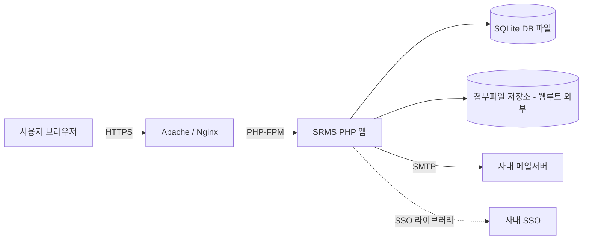
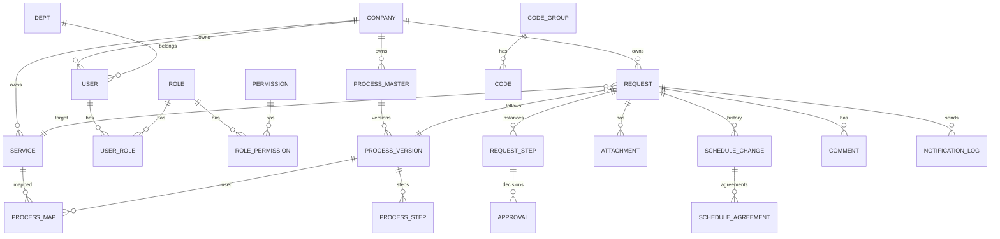
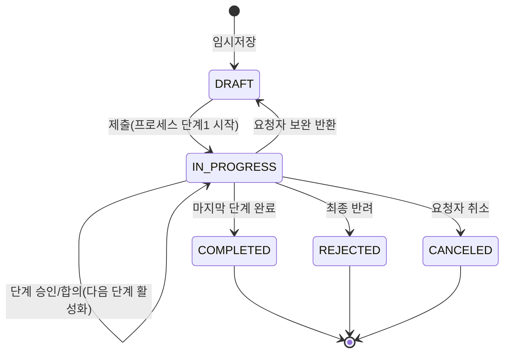
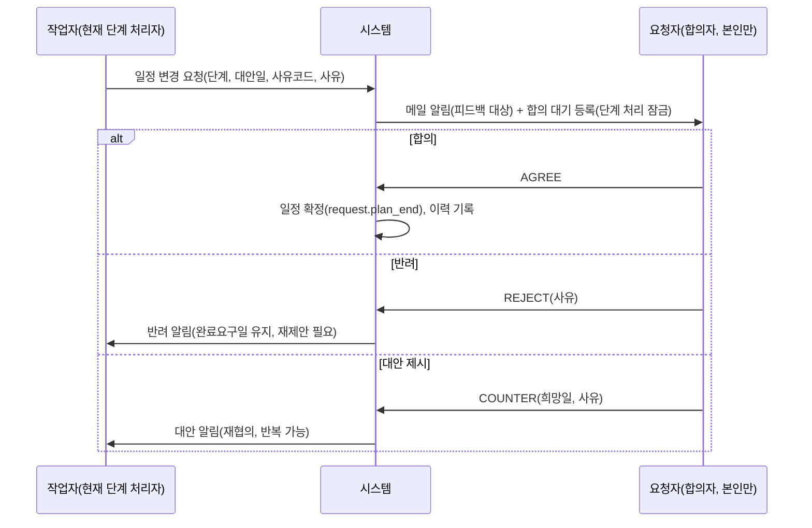

# SRMS 설계서 (System Maintenance Request Management System)

- 문서 상태: **초안 (검토용)**
- 작성 기준: [요구사항.md](요구사항.md)
- 가정/미확정 사항은 `[확인필요]`로 표기하며 12장에 모아 정리함

---

## 1. 개요

### 1.1 목적
현업의 시스템 유지보수 요청을 접수하고, **화면에서 정의한 유지보수 프로세스(결재/합의 단계)** 에 따라 처리하며, 처리 결과를 **실적으로 관리/리포팅** 한다.

### 1.2 핵심 컨셉
1. 사용자/롤/권한을 관리한다.
2. 권한자(시스템관리자)가 **프로세스 마스터(단계)** 를 화면에서 설정한다. 버전과 유효기간을 가진다.
3. 현업은 **시스템(서비스) × 유지보수 타입** 에 매핑된 프로세스로 요청을 등록하고, 시스템은 그 프로세스대로 진행한다.
4. 각 단계 전환 시 **메일 알림** 을 발송한다.
5. 롤별로 진행 현황을 **한눈에** 볼 수 있다.
6. 작업자가 완료요구일을 맞출 수 없을 때 일정 변경을 요청하고 요청자와 합의하며, 사유와 합의 이력이 기록된다(6.4).

### 1.3 요구사항 추적표

| 구분 | 요구사항 | 반영 위치 |
|---|---|---|
| R1 | 유지보수 타입별 전산팀–현업 합의/결재 프로세스, 화면 설정 | 6장, 8.3 |
| R2 | 프로세스 유효기간/버전 관리 | 5.3, 6.2 |
| R3 | 프로세스 수정은 시스템관리자만 | 4장 |
| R4 | 신청은 텍스트 + 첨부파일 | 5.4, 9장 |
| R5 | 현업: 본인 신청 흐름 한눈에 | 8.1 |
| R6 | 현업 전산팀원/전산팀: 역할별 진행 현황 대시보드 | 8.2 |
| R7 | 롤 3개 내외 | 4장 |
| R8 | 서비스/담당자/타입별 실적 리포트 | 10장 |
| R9 | SQLite, 설치형 | 3장, 13장 |
| R10 | PHP, Apache/Nginx 동시 지원 | 3장, 13장 |
| R11 | 로그인 + 사내 SSO 연동 | 11.1 |
| R12 | 공통코드/사용자/롤/권한/프로세스마스터/접수/승인현황/진행현황/리포트차트 | 5장, 7장 |
| R13 | 무료 텍스트 에디터, CDN 금지(라이브러리 로컬 포함) | 3.2 |
| R14 | 단계별 메일 알림 | 9.4 |
| R15 | 완료요구일 협의(일정 변경 사유/상호 합의 기록) | 6.4 |
| R16 | 다국어(기본 한국어, 선택 일본어/영어) | 9.5 |
| R17 | 단계별 첨부파일 허용/필수 설정 | 5.3, 8.3, 9.2 |
| R18 | 메일은 단계별 피드백 대상자에게만 발송 | 9.4 |
| R19 | 단계별 참조자 지정 및 참조자 메일 수신 옵션 | 5.3, 8.3, 9.4 |
| R20 | 여러 그룹사 사용: 모든 테이블 최상위에 회사코드 | 5.3, 5.5 |

---

## 2. 시스템 구성



- 단일 서버 설치형. 외부 DB 서버 불필요.
- 웹서버는 Apache/Nginx 모두 지원(앱은 웹서버 종속 기능 미사용, `.htaccess` 비의존, 라우팅은 `index.php` 프론트 컨트롤러 1개로 처리).
- 첨부파일과 DB 파일은 **웹루트 밖** 에 저장하고 PHP를 통해서만 다운로드.

---

## 3. 기술 스택

### 3.1 서버
| 항목 | 선택 | 비고 |
|---|---|---|
| 언어 | PHP **최신 안정 버전 (8.5.x)** | 서버 설치는 사용자가 수행. 코드는 8.5 기준으로 작성 |
| PHP 확장 | `pdo_sqlite`, `sqlite3`, `mbstring`, `fileinfo`, `openssl`, `intl`(선택), `zip`(엑셀 내보내기 시) | |
| DB | SQLite 3.35+ (WAL 모드) | 동시 쓰기 소수 규모에 적합 |
| 웹서버 | Apache 2.4 (mod_php 또는 php-fpm) / Nginx (php-fpm) | 설정 샘플 제공 |
| 메일 | SMTP 직접 연동 (PHPMailer 번들) | SMTP 정보는 `.env` 에 사용자가 직접 입력 |
| 구조 | 경량 자체 MVC (프레임워크 미사용) + Composer 미필수 | 설치 단순화를 위해 vendor 폴더를 배포 패키지에 포함 |

> 프레임워크 없이 가는 이유: 설치형/유지보수 용이성. 대안으로 Slim 등 마이크로 프레임워크 가능(검토 시 변경 가능).

### 3.2 프론트엔드 (모두 로컬 번들, CDN 사용 금지)
| 용도 | 라이브러리 | 라이선스 |
|---|---|---|
| UI | Bootstrap 5 (CSS/JS 로컬) | MIT |
| 텍스트 에디터 | **Quill 2.x** (채택) | BSD-3. API 키/클라우드 불필요, 가벼움, 로컬 번들 용이 |
| 차트 | Chart.js | MIT |
| 테이블 | 서버사이드 렌더 + 경량 JS | - |
| 프로세스 설계 UI | 순서 변경 가능한 단계 목록(SortableJS) | MIT |
| 아이콘 | Bootstrap Icons (로컬 폰트) | MIT |

- 모든 정적 자원은 `public/assets/vendor/` 에 포함.
- CSP 헤더에서 `default-src 'self'` 로 외부 로드를 차단하여 CDN 미사용을 강제.

---

## 4. 롤 및 권한

### 4.1 롤 정의
요구사항의 "3개 정도의 롤"과 "프로세스 수정은 시스템관리자만"을 종합하여 다음과 같이 정의함. (현업 전산담당 = 현업 부서 소속 IT 담당자, 확정)

| 롤 코드 | 롤명 | 설명 | 조망 범위 |
|---|---|---|---|
| `REQUESTER` | 현업 사용자 | 유지보수 신청자 | 본인이 신청한 건의 흐름 |
| `BIZ_IT` | 현업 전산담당 | 현업 주관부서 소속 전산담당자. 승인/합의 참여 | 자기 부서(주관부서) 건의 요청+진행 |
| `IT_TEAM` | 전산팀 | 유지보수 수행/관리(팀장 포함) | 관리범위 전체 건의 진행 |
| `SYS_ADMIN` | 시스템관리자 | 프로세스/코드/사용자/롤 설정 | 전체(설정 권한) |

- 업무 롤 3개 + 관리 롤 1개. 한 사용자가 복수 롤을 가질 수 있음(`user_role` 다대다).
- 모든 롤의 범위는 **소속 회사(`company_cd`) 내부**로 한정. 시스템관리자도 자기 회사 데이터만 관리함(5.5).
- 팀장은 `IT_TEAM` 롤 + 리포트 열람/승인 권한으로 구성.

### 4.2 권한 모델
메뉴/기능 단위의 **권한 코드**를 롤에 매핑(RBAC). 데이터 범위는 롤 + 소속부서로 서버에서 필터링.

| 권한 코드 | REQUESTER | BIZ_IT | IT_TEAM | SYS_ADMIN |
|---|:-:|:-:|:-:|:-:|
| `REQUEST_CREATE` 요청 등록 | O | O | O | O |
| `REQUEST_VIEW_OWN` 본인 건 조회 | O | O | O | O |
| `REQUEST_VIEW_DEPT` 주관부서 건 조회 | | O | O | O |
| `REQUEST_VIEW_ALL` 전체 건 조회 | | | O | O |
| `REQUEST_VIEW_CC` 참조 지정된 건 조회(읽기 전용) | 단계 지정 시 | 단계 지정 시 | 단계 지정 시 | O |
| `STEP_ACT` 단계 처리(승인/반려/합의) | 단계 지정 시 | 단계 지정 시 | 단계 지정 시 | O |
| `SCHEDULE_PROPOSE` 일정 변경 제안/합의 | 단계 지정 시 | O | O | O |
| `REPORT_VIEW` 리포트 | | 부서범위 | O | O |
| `PROCESS_EDIT` 프로세스 마스터 수정 | | | | **O (유일)** |
| `CODE_EDIT` 공통코드 관리 | | | | O |
| `SERVICE_EDIT` 서비스 관리 | | | | O |
| `USER_EDIT` 사용자/롤/권한 관리 | | | | O |
| `WORKLOG_REG` 작업일지 등록·관리(8.5) | | | O | O |
| `REQUEST_SPLIT` 요청 분할·담당자 지정(8.6) | | | O | O |

- 단계별 처리자는 프로세스 단계에서 "처리자 유형(롤/지정자/요청자 부서장 등)"으로 정의(6.1).
- 권한 체크는 라우터 미들웨어에서 일괄 수행, 화면 버튼 숨김만으로 제어하지 않음.

---

## 5. 데이터 설계 (SQLite)

### 5.1 ERD



### 5.2 테이블 목록

| 영역 | 테이블 | 설명 |
|---|---|---|
| 회사 | `company` | 그룹사(회사) 마스터. 이하 모든 테이블이 `company_cd` 를 최상위 키로 가짐(5.5) |
| 공통 | `code_group`, `code` | 공통코드 (서비스구분, 유지보수 타입, 우선순위 등) |
| 조직/사용자 | `dept`, `user`, `role`, `user_role`, `permission`, `role_permission` | |
| 서비스 | `service`, `service_biz_it` | 관리범위 내 시스템(서비스), 주관부서, 현업 IT 담당자(다수), 전산 담당자 |
| 프로세스 | `process_master`, `process_version`, `process_step`, `process_step_cc`, `process_map` | 프로세스 정의/버전/단계/단계별 참조자/적용 매핑 |
| 접수 | `request`, `attachment`, `comment` | 유지보수 신청 |
| 진행 | `request_step`, `approval` | 요청별 단계 인스턴스/결재 이력 |
| 일정 | `schedule_change`, `schedule_agreement` | 일정 변경 사유/합의 이력 |
| 알림 | `notification_log`, `mail_template` | 메일 발송 이력/템플릿 |
| 감사 | `audit_log` | 로그인, 설정변경, 주요 처리 이력 |
| 설정 | `app_setting`, `sso_binding` | 환경설정, SSO 계정 매핑 |
| 다국어 | `translation` | 마스터 데이터 명칭의 언어별 번역 |

### 5.3 주요 테이블 DDL (발췌)

```sql
PRAGMA foreign_keys = ON;
PRAGMA journal_mode = WAL;

-- 회사(그룹사): 모든 데이터의 최상위 구분자
CREATE TABLE company (
  company_cd   TEXT PRIMARY KEY,        -- 예: 'HQ', 'A01'
  company_nm   TEXT NOT NULL,
  default_lang TEXT NOT NULL DEFAULT 'ko',
  use_yn       INTEGER NOT NULL DEFAULT 1,
  created_at   TEXT NOT NULL
);

-- 이하 모든 테이블(permission 제외)은 company_cd 를 첫 컬럼으로 가지며
-- 업무키 UNIQUE / 복합 PK / 인덱스는 company_cd 를 선두로 한다.

-- 공통코드
CREATE TABLE code_group (
  company_cd TEXT NOT NULL REFERENCES company(company_cd),
  group_cd   TEXT NOT NULL,             -- SERVICE_TYPE, MAINT_TYPE, PRIORITY ...
  group_nm   TEXT NOT NULL,
  use_yn     INTEGER NOT NULL DEFAULT 1,
  PRIMARY KEY (company_cd, group_cd)
);
CREATE TABLE code (
  company_cd TEXT NOT NULL,
  group_cd   TEXT NOT NULL,
  code_cd    TEXT NOT NULL,
  code_nm    TEXT NOT NULL,
  sort_no    INTEGER NOT NULL DEFAULT 0,
  use_yn     INTEGER NOT NULL DEFAULT 1,
  PRIMARY KEY (company_cd, group_cd, code_cd),
  FOREIGN KEY (company_cd, group_cd) REFERENCES code_group(company_cd, group_cd)
);

-- 사용자/조직
CREATE TABLE dept (
  company_cd TEXT NOT NULL REFERENCES company(company_cd),
  dept_id    INTEGER PRIMARY KEY,
  dept_nm    TEXT NOT NULL,
  is_it      INTEGER NOT NULL DEFAULT 0    -- 전산팀 여부
);
CREATE TABLE user (
  company_cd TEXT NOT NULL REFERENCES company(company_cd),   -- 사용자는 1개 회사에 소속
  user_id    INTEGER PRIMARY KEY,
  login_id   TEXT NOT NULL,                -- SSO 사번/ID와 동일 권장 (회사 내 유일)
  user_nm    TEXT NOT NULL,
  email      TEXT NOT NULL,
  dept_id    INTEGER REFERENCES dept(dept_id),
  pw_hash    TEXT,                         -- 로컬 로그인용(SSO 미사용 시), password_hash()
  use_yn     INTEGER NOT NULL DEFAULT 1,
  lang       TEXT NOT NULL DEFAULT 'ko',   -- ko / ja / en
  last_login TEXT,
  UNIQUE (company_cd, login_id)
);

-- 다국어: 마스터 명칭 번역 (기본 명칭은 각 테이블의 *_nm 컬럼 = ko)
CREATE TABLE translation (
  company_cd TEXT NOT NULL REFERENCES company(company_cd),
  entity     TEXT NOT NULL,                -- CODE / SERVICE / PROCESS / STEP / ROLE / PERMISSION ...
  entity_key TEXT NOT NULL,                -- 예: 'MAINT_TYPE:NEW_DEV', 'STEP:12'
  lang       TEXT NOT NULL,                -- ja / en
  text       TEXT NOT NULL,
  PRIMARY KEY (company_cd, entity, entity_key, lang)
);

-- 메일 템플릿: 언어별 행
CREATE TABLE mail_template (
  company_cd TEXT NOT NULL REFERENCES company(company_cd),
  tmpl_cd    TEXT NOT NULL,
  lang       TEXT NOT NULL,                -- ko / ja / en
  subject    TEXT NOT NULL,
  body       TEXT NOT NULL,
  PRIMARY KEY (company_cd, tmpl_cd, lang)
);
CREATE TABLE role (
  company_cd TEXT NOT NULL REFERENCES company(company_cd),
  role_cd    TEXT NOT NULL,
  role_nm    TEXT NOT NULL,
  PRIMARY KEY (company_cd, role_cd)
);
CREATE TABLE user_role (
  company_cd TEXT NOT NULL,
  user_id    INTEGER NOT NULL REFERENCES user(user_id),
  role_cd    TEXT    NOT NULL,
  PRIMARY KEY (company_cd, user_id, role_cd),
  FOREIGN KEY (company_cd, role_cd) REFERENCES role(company_cd, role_cd)
);
CREATE TABLE permission (          -- 시스템 정의 권한: 회사 공통(company_cd 없음)
  perm_cd    TEXT PRIMARY KEY,
  perm_nm    TEXT NOT NULL
);
CREATE TABLE role_permission (     -- 롤-권한 매핑은 회사별로 관리
  company_cd TEXT NOT NULL,
  role_cd    TEXT NOT NULL,
  perm_cd    TEXT NOT NULL REFERENCES permission(perm_cd),
  PRIMARY KEY (company_cd, role_cd, perm_cd),
  FOREIGN KEY (company_cd, role_cd) REFERENCES role(company_cd, role_cd)
);

-- 서비스(관리범위 시스템)
CREATE TABLE service (
  company_cd   TEXT NOT NULL REFERENCES company(company_cd),
  service_id   INTEGER PRIMARY KEY,
  service_cd   TEXT NOT NULL,
  service_nm   TEXT NOT NULL,
  biz_dept_id  INTEGER REFERENCES dept(dept_id),  -- 현업 주관부서
  it_owner_id  INTEGER REFERENCES user(user_id),  -- 전산 담당자
  use_yn       INTEGER NOT NULL DEFAULT 1,
  UNIQUE (company_cd, service_cd)
);
-- 서비스별 현업 IT 담당자(주관부서 소속 BIZ_IT 사용자 중 지정, 다수 가능). 마이그레이션 012
CREATE TABLE service_biz_it (
  company_cd TEXT NOT NULL,
  service_id INTEGER NOT NULL,
  user_id    INTEGER NOT NULL,
  PRIMARY KEY (company_cd, service_id, user_id)
);

-- 프로세스 마스터 / 버전 / 단계
CREATE TABLE process_master (
  company_cd   TEXT NOT NULL REFERENCES company(company_cd),
  process_id   INTEGER PRIMARY KEY,
  process_cd   TEXT NOT NULL,
  process_nm   TEXT NOT NULL,
  description  TEXT,
  UNIQUE (company_cd, process_cd)
);
CREATE TABLE process_version (
  company_cd   TEXT NOT NULL REFERENCES company(company_cd),
  version_id   INTEGER PRIMARY KEY,
  process_id   INTEGER NOT NULL REFERENCES process_master(process_id),
  version_no   INTEGER NOT NULL,
  valid_from   TEXT NOT NULL,                -- YYYY-MM-DD
  valid_to     TEXT,                         -- NULL = 무기한
  status       TEXT NOT NULL DEFAULT 'DRAFT',-- DRAFT / ACTIVE / RETIRED
  created_by   INTEGER REFERENCES user(user_id),
  created_at   TEXT NOT NULL,
  UNIQUE (process_id, version_no)
);
CREATE TABLE process_step (
  company_cd     TEXT NOT NULL REFERENCES company(company_cd),
  step_id        INTEGER PRIMARY KEY,
  version_id     INTEGER NOT NULL REFERENCES process_version(version_id),
  step_no        INTEGER NOT NULL,
  step_nm        TEXT NOT NULL,
  step_type      TEXT NOT NULL,   -- SUBMIT / APPROVE / AGREE / WORK / REVIEW / CLOSE
  actor_type     TEXT NOT NULL,   -- ROLE / USER / REQUESTER / SERVICE_IT_OWNER / SERVICE_BIZ_OWNER / SERVICE_BIZ_DEPT
  actor_value    TEXT,            -- 롤코드 또는 user_id
  approval_mode  TEXT NOT NULL DEFAULT 'ANY', -- ANY / ALL (복수 처리자)
  allow_reject   INTEGER NOT NULL DEFAULT 1,
  reject_to_step INTEGER,                    -- 반려 시 이동 단계(NULL=요청자에게 반환)
  due_days       INTEGER,                    -- 표준 처리기한(영업일)
  notify_tmpl    TEXT,                       -- 메일 템플릿 코드 (수신자 = 이 단계의 피드백 대상자)
  attach_mode    TEXT NOT NULL DEFAULT 'NONE',  -- NONE(불가) / OPTIONAL(선택) / REQUIRED(필수)
  attach_max_cnt INTEGER,                    -- 단계 내 최대 파일 수 (NULL=전역 기본값)
  attach_max_mb  INTEGER,                    -- 파일당 최대 MB (NULL=전역 기본값)
  attach_exts    TEXT,                       -- 허용 확장자 목록 "pdf,xlsx,png" (NULL=전역 화이트리스트)
  UNIQUE (version_id, step_no)
);
CREATE TABLE process_step_cc (     -- 단계별 참조자 (피드백 의무 없음, 조회/통보 대상)
  company_cd   TEXT NOT NULL REFERENCES company(company_cd),
  cc_id        INTEGER PRIMARY KEY,
  step_id      INTEGER NOT NULL REFERENCES process_step(step_id),
  cc_type      TEXT NOT NULL,   -- ROLE / USER / DEPT / REQUESTER / SERVICE_IT_OWNER / SERVICE_BIZ_OWNER / SERVICE_BIZ_DEPT
  cc_value     TEXT,            -- 롤코드 / user_id / dept_id
  notify_on    TEXT NOT NULL DEFAULT 'NONE'  -- 메일 옵션: NONE / ACTIVATE(단계 시작) / COMPLETE(단계 완료) / BOTH
);
CREATE TABLE process_map (       -- 서비스 × 유지보수타입 → 프로세스
  company_cd   TEXT NOT NULL REFERENCES company(company_cd),
  map_id       INTEGER PRIMARY KEY,
  service_id   INTEGER NOT NULL REFERENCES service(service_id),
  maint_type   TEXT    NOT NULL,                -- code(MAINT_TYPE)
  process_id   INTEGER NOT NULL REFERENCES process_master(process_id),
  UNIQUE (service_id, maint_type)
);

-- 유지보수 요청
CREATE TABLE request (
  company_cd    TEXT NOT NULL REFERENCES company(company_cd),
  request_id    INTEGER PRIMARY KEY,
  request_no    TEXT NOT NULL,                  -- SR-YYYYMM-0001 (회사별 채번, 회사 내 유일)
  service_id    INTEGER NOT NULL REFERENCES service(service_id),
  maint_type    TEXT NOT NULL,                  -- NEW_DEV / MODIFY / BUGFIX / DATA / ETC ...
  title         TEXT NOT NULL,
  content_html  TEXT NOT NULL,                  -- 서버에서 sanitize 후 저장
  priority      TEXT,
  version_id    INTEGER NOT NULL REFERENCES process_version(version_id), -- 접수 시점 버전 고정
  requester_id  INTEGER NOT NULL REFERENCES user(user_id),
  it_assignee_id INTEGER REFERENCES user(user_id),
  status        TEXT NOT NULL,                  -- DRAFT / IN_PROGRESS / COMPLETED / REJECTED / CANCELED
  current_step_no INTEGER,
  req_due_date  TEXT NOT NULL,                  -- 완료요구일(필수, 약속된 일정)
  plan_start    TEXT, plan_end TEXT,            -- 합의된 현재 일정
  actual_end    TEXT,
  effort_hours  REAL,                           -- (011) 투입시간(시간, 소수 둘째 자리), 실적용. MD 환산 없이 시간으로만 입력·저장·집계(기존 effort_md 는 제거)
  request_date  TEXT,                           -- (007) 작업일지의 실제 요청일. 일반 SR 은 최초 제출일(009, 재제출·분할 시 불변/상속), 임시저장은 NULL
  channel       TEXT,                           -- (007) 접수 채널, 공통코드 CONTACT_CHANNEL
  reg_by        INTEGER,                        -- (007) 사후등록한 IT 담당자. NULL 이 아니면 작업일지 건
  parent_id     INTEGER,                        -- (008) SR 분할로 생기면 원본 request_id
  split_by      INTEGER,                        -- (008) 분할한 사용자
  canceled_at   TEXT,                           -- (010) 취소일(YYYY-MM-DD). 월간 현황표의 취소·월말 진행 계산에 쓴다
  created_at    TEXT NOT NULL,
  updated_at    TEXT NOT NULL,
  UNIQUE (company_cd, request_no)
);
CREATE TABLE attachment (
  company_cd   TEXT NOT NULL REFERENCES company(company_cd),
  attach_id    INTEGER PRIMARY KEY,
  request_id   INTEGER NOT NULL REFERENCES request(request_id),
  step_no      INTEGER,                         -- 업로드된 단계 (1단계=신청 시 첨부)
  orig_name    TEXT NOT NULL,
  stored_name  TEXT NOT NULL,                   -- 난수 파일명
  mime_type    TEXT, size_byte INTEGER, sha256 TEXT,
  uploaded_by  INTEGER NOT NULL REFERENCES user(user_id),
  uploaded_at  TEXT NOT NULL
);

-- 요청별 단계 인스턴스 및 결재 이력
CREATE TABLE request_step (
  company_cd   TEXT NOT NULL REFERENCES company(company_cd),
  rstep_id     INTEGER PRIMARY KEY,
  request_id   INTEGER NOT NULL REFERENCES request(request_id),
  step_no      INTEGER NOT NULL,
  step_nm      TEXT NOT NULL,                   -- 접수 시점 스냅샷
  status       TEXT NOT NULL,                   -- WAITING / ACTIVE / DONE / REJECTED / SKIPPED
  started_at   TEXT, due_at TEXT, ended_at TEXT,
  UNIQUE (request_id, step_no, rstep_id)
);
CREATE TABLE approval (
  company_cd   TEXT NOT NULL REFERENCES company(company_cd),
  approval_id  INTEGER PRIMARY KEY,
  rstep_id     INTEGER NOT NULL REFERENCES request_step(rstep_id),
  actor_id     INTEGER NOT NULL REFERENCES user(user_id),
  action       TEXT NOT NULL,                   -- APPROVE / REJECT / AGREE / RETURN / COMPLETE
  opinion      TEXT,
  acted_at     TEXT NOT NULL
);

-- 일정 변경/합의
CREATE TABLE schedule_change (
  company_cd   TEXT NOT NULL REFERENCES company(company_cd),
  change_id    INTEGER PRIMARY KEY,
  request_id   INTEGER NOT NULL REFERENCES request(request_id),
  step_no      INTEGER,                         -- 어느 단계의 일정인지
  prev_start   TEXT, prev_end TEXT,
  new_start    TEXT, new_end  TEXT,
  reason_cd    TEXT NOT NULL,                   -- code(SCHEDULE_REASON): 범위변경/리소스/선행지연/현업요청...
  reason_text  TEXT NOT NULL,
  proposer_id  INTEGER NOT NULL REFERENCES user(user_id),   -- 항상 작업자(제안자 구분 컬럼 없음, 마이그레이션 004)
  status       TEXT NOT NULL,                   -- PROPOSED / AGREED / REJECTED / COUNTERED / WITHDRAWN (요청당 PROPOSED 1건: 부분 유니크 인덱스)
  proposed_at  TEXT NOT NULL,
  resolved_at  TEXT
);
CREATE TABLE schedule_agreement (
  company_cd   TEXT NOT NULL REFERENCES company(company_cd),
  agreement_id INTEGER PRIMARY KEY,
  change_id    INTEGER NOT NULL REFERENCES schedule_change(change_id),
  user_id      INTEGER NOT NULL REFERENCES user(user_id),   -- 항상 요청자 본인
  decision     TEXT NOT NULL,                   -- AGREE / REJECT / COUNTER
  comment      TEXT,                            -- REJECT/COUNTER 는 필수
  counter_end  TEXT,                            -- COUNTER 의 희망 완료일(오늘 이후, 제안일보다 이전)
  decided_at   TEXT NOT NULL
);

-- 알림/감사
CREATE TABLE notification_log (
  company_cd   TEXT NOT NULL REFERENCES company(company_cd),
  noti_id      INTEGER PRIMARY KEY,
  request_id   INTEGER REFERENCES request(request_id),
  to_user_id   INTEGER REFERENCES user(user_id),
  to_email     TEXT NOT NULL,
  rcpt_kind    TEXT NOT NULL DEFAULT 'TO',     -- TO(피드백 대상) / CC(참조자)
  subject      TEXT NOT NULL,
  status       TEXT NOT NULL,                   -- QUEUED / SENT / FAILED
  err_msg      TEXT,
  created_at   TEXT NOT NULL, sent_at TEXT
);
CREATE TABLE audit_log (
  company_cd   TEXT NOT NULL REFERENCES company(company_cd),
  audit_id     INTEGER PRIMARY KEY,
  user_id      INTEGER, action TEXT NOT NULL, target TEXT, detail TEXT,
  ip_addr      TEXT, created_at TEXT NOT NULL
);
```

### 5.4 설계 원칙
- **버전 고정**: 요청 접수 시 유효한 `process_version`을 `request.version_id` 에 고정. 이후 프로세스가 개정되어도 진행 중 건은 영향 없음. 단계 명칭은 `request_step` 에 스냅샷 저장.
- **이력 불변**: `approval`, `schedule_change`, `schedule_agreement`, `audit_log`는 INSERT 전용(수정/삭제 없음).
- **삭제 정책**: 마스터/사용자는 논리삭제(`use_yn`), 요청은 삭제하지 않고 `CANCELED` 상태 처리.
- **SQLite 운용**: WAL 모드, `busy_timeout=5000`, 쓰기는 짧은 트랜잭션, 상태전이는 `BEGIN IMMEDIATE`로 직렬화. 일일 백업(DB 파일 복사 + `VACUUM INTO`).

### 5.5 멀티컴퍼니(회사코드) 원칙
- **모든 테이블의 첫 컬럼은 `company_cd`** (예외: 회사 마스터 `company` 자신, 시스템 정의 `permission`). 하나의 SQLite DB 파일을 여러 그룹사가 공유하고 회사코드로 논리 분리.
- 업무키 `UNIQUE`, 복합 `PK`, 조회용 인덱스는 모두 `company_cd` 를 선두 컬럼으로 구성(예: `(company_cd, status)`, `(company_cd, service_id)`).
- **격리 보장**
  1. 로그인 시 사용자의 `company_cd` 를 세션에 고정. 클라이언트가 전달하는 회사코드는 신뢰하지 않음.
  2. 모든 쿼리는 데이터 접근 계층(Repository)이 `WHERE company_cd = :세션회사` 를 **강제로 부가**. 회사코드 없는 쿼리는 허용하지 않음.
  3. INSERT 시 `company_cd` 는 세션 값으로 자동 설정하고, 자식 행은 부모 행과 `company_cd` 가 같은지 검증(핵심 관계는 복합 FK, 나머지는 Repository 검증).
  4. URL 의 ID(요청 ID 등)로 조회할 때도 회사코드를 함께 조건에 포함하여 타사 데이터 접근(IDOR)을 차단.
- **회사별 독립 항목**: 공통코드, 조직/사용자, 롤-권한 매핑, 서비스, 프로세스 마스터/버전, 요청/진행 데이터, 메일 템플릿, 번역, 요청번호 채번(`SR-YYYYMM-NNNN` 이 회사별로 독립).
- **회사 공통 항목**: `permission`(시스템 정의 권한 코드), 화면 문구 번역 파일(`lang/*.php`), 설치 `.env`(SMTP 등).
- **로그인**: 로그인 화면에서 회사를 선택하고 로그인ID + 비밀번호로 인증(`UNIQUE (company_cd, login_id)`). SSO 적용 시 SSO 가 전달하는 소속 회사 정보를 `company_cd` 로 매핑(후속 구현).
- **회사 등록**: 신규 회사 추가는 `php bin/company.php add <회사코드> <회사명>` 으로 수행 — 회사 레코드 생성 + 기본 롤/권한/공통코드/기본 프로세스(일반·긴급)/메일 템플릿 시드 + 초기 시스템관리자 생성. 회사 간 전환이나 그룹 통합 조회 화면은 두지 않음(`[확인필요]`).
- **파일**: 첨부는 `storage/attachments/{company_cd}/YYYY/MM/난수파일명` 으로 회사별 분리 저장.
- **리포트/알림/감사**: 모두 회사 범위 안에서만 집계·발송·기록되며, 메일 링크에도 회사코드를 포함.

---

## 6. 프로세스 엔진 설계

### 6.1 프로세스 정의 모델
- **프로세스 마스터**: 프로세스 종류(예: 일반 수정, 신규개발, 긴급 장애).
- **버전**: 마스터의 개정본. `DRAFT → ACTIVE → RETIRED`.
- **단계(step)**: 순서, 단계유형, 처리자 유형, 승인방식(ANY/ALL), 반려 시 이동 단계, 표준기한, 알림 템플릿.
- **적용 매핑**: `서비스 × 유지보수 타입 → 프로세스` (`process_map`). 현업이 요청 등록 시 서비스와 타입을 선택하면 프로세스가 자동 결정되고 미리보기로 단계 흐름을 보여줌.
  - 요구사항의 "현업은 시스템별 유지보수 타입별 프로세스를 선택" 을 만족.

**단계 유형**

| step_type | 의미 |
|---|---|
| `SUBMIT` | 요청 제출(시작) |
| `REVIEW` | 전산팀 검토/접수 판단 |
| `AGREE` | 전산팀–현업 합의(범위/공수/일정) |
| `APPROVE` | 결재(승인/반려) |
| `WORK` | 개발/수정 수행, 진행률/완료 입력 |
| `VERIFY` | 현업 검수 |
| `CLOSE` | 종료 |

### 6.2 버전/유효기간 규칙
1. 활성 버전 수정 불가. 수정 시 **새 버전(DRAFT) 복제 생성** → 편집 → 활성화.
2. 새 버전 활성화 시 `valid_from` 이후 신규 접수 건부터 적용. 이전 버전은 `valid_to = 새 valid_from - 1일`, `RETIRED`.
3. 동일 프로세스에서 유효기간이 겹치는 `ACTIVE` 버전은 존재할 수 없음(저장 시 검증).
   - 종료일이 없는 새 버전: 시작일이 앞선 기존 활성 버전은 시작일 전날로 자동 종료. 시작일이 같거나 뒤인 기존 활성 버전은 **사용 이력이 없거나 오늘 이후 시작이면 대체(종료)**, 그 외에는 겹침 오류.
   - 종료일이 있는 새 버전: 겹치는 활성 버전이 있으면 항상 오류(자동 분할하지 않음).
4. 유효기간 만료 시 해당 프로세스에 활성 버전이 없으면 신규 접수 차단 + 관리자 알림.
5. 활성화/수정/삭제는 `PROCESS_EDIT`(SYS_ADMIN) 만 가능, 모든 변경은 `audit_log` 기록.
6. **적용 버전 결정 방식 (둘 다 지원)**
   - 유효기간 방식: 버전별 `valid_from/valid_to` 를 설정하면 접수일 기준으로 해당하는 버전이 자동 선택됨.
   - 즉시 전환 방식: 관리자가 새 버전을 "활성화(즉시 적용)" 하면 `valid_from = 오늘`, 기존 활성 버전은 `valid_to = 어제` 로 자동 종료.
7. **기존 실적 유지**: 요청은 접수 시점의 버전(`request.version_id`)에 고정되므로 A2 활성화 후에도 A1 건은 A1 단계대로 끝까지 진행되고, 완료된 A1 실적과 이력도 그대로 보존됨. 신규 접수 건만 A2를 따름.
8. 이미 진행 중인 A1 건을 A2로 옮기는 기능은 제공하지 않음(필요 시 요청 취소 후 재등록). `[확인필요]`
9. 리포트에서 프로세스 버전별 집계/필터 가능(A1 대비 A2 처리기간 비교 등).
10. 사용 이력이 있는 버전은 삭제 불가(RETIRED 처리만 가능).

### 6.3 요청 상태 전이



**단계 처리 알고리즘**
1. 제출 시: 버전 결정 → `request_step` 전체 생성(`WAITING`) → 1단계 `ACTIVE`, 처리자 해석, 메일 발송.
2. 처리(승인/합의/완료): 권한/처리자 검증 → `approval` INSERT → 승인방식(ANY/ALL) 충족 여부 판정 → 충족 시 단계 `DONE`, 다음 단계 `ACTIVE`.
3. 반려: `reject_to_step` 으로 되돌림(해당 단계 이후 `WAITING`으로 초기화, 이력은 보존) 또는 최종 반려.
4. 마지막 단계 완료 시 `COMPLETED`, `actual_end` 기록.
5. 모든 전이는 하나의 트랜잭션 내에서 수행하며, 알림은 트랜잭션 커밋 후 큐에 적재.

### 6.4 일정조율 (완료요구일 협의)

> **2026-11-06 결정**: 일정조율은 프로세스(단계/처리자를 갖는 버전)가 아니다. 프로세스 마스터에서 `SCHEDULE` 시드와 `is_system` 구분을 제거했다.
> 요청(SR)의 **완료요구일**을 작업자가 맞출 수 없을 때 사용하는 **요청 단위 기능**이다.

**개념**
- SR 은 완료요구일(`request.req_due_date`)을 반드시 가진다. 이 날짜가 운영자(작업자)의 일정과 맞지 않을 수 있다.
- 작업자가 맞출 수 없으면, 등록된 프로세스의 **자신이 처리하는 단계에서** 일정 변경을 요청한다: **가능한 완료일(대안일) + 변경 사유 코드 + 상세 사유**.
- 요청자(현업)가 **합의 / 반려 / 대안 제시(COUNTER)** 한다. 합의되면 일정이 확정(`request.plan_end` 갱신)되고, 아니면 기존 완료요구일이 유지된다.
- 모든 제안·합의·반려·대안은 이력으로 보존된다: 어느 **단계**에서, 누가, 왜(사유), 어떤 날짜로 변경을 요청했고 누가 동의했는지.
- 프로세스 정의와 무관하게 동작한다(어떤 프로세스의 어떤 단계든 처리 권한이 있는 작업자가 요청 가능).



**규칙**
- **일정 변경은 작업자가 제안하고 요청자 본인만 합의한다.** 현업 전산담당이 대신 합의할 수 없고, 현업이 먼저 완료요구일을 바꾸는 경우는 없다(제안자 구분 불필요).
- **완료요구일은 모든 SR 에 필수**(모든 일은 약속된 일정). 등록 시 입력을 강제하며 일정 변경의 기준이 된다.
- 한 요청에 진행 중인 일정 변경 협의는 1건만 허용.
- **합의 대기 중에는 해당 요청의 단계 처리(승인/반려/합의/완료 등)를 할 수 없다.** 협의가 끝나야(합의 또는 반려) 진행된다. 엔진이 처리 시점에 협의 중인 건이 있는지 확인해 거부한다.
- 합의 전까지 기존 완료요구일이 유효하다. 응답기한(기본 3영업일, 설정 가능) 초과 시 요청자에게 독촉 메일.
- **반려 후 작업자가 재제안하지 않아도 별도 조치(자동 에스컬레이션 등)를 하지 않는다.** 그대로 두면 완료요구일 대비 **지연 실적**으로 관리된다(10장).
- 메일 수신자는 9.4의 원칙(피드백이 필요한 사람)을 따른다: 제안 → 요청자, 반려/대안 → 작업자.
- 일정 변경 횟수/누적 지연일/합의 소요시간은 리포트 지표로 제공.
- 구현(M4, 마이그레이션 004): `proposer_side`/`side` 컬럼 제거, `schedule_agreement.counter_end` 추가, 요청당 협의 대기 1건을 부분 유니크 인덱스로 강제. 제안 시 날짜는 현재 유효 목표일(`plan_end` ?? `req_due_date`)보다 늦어야 하며, COUNTER 는 제안일보다 앞선 오늘 이후 날짜여야 한다. 요청 취소 시 협의 대기 건은 WITHDRAWN 으로 정리. 협의 상태 변경(status/resolved_at)을 제외한 제안·응답 행은 수정·삭제하지 않는다.
- 응답기한(기본 3영업일, `SCHEDULE_RESPONSE_DAYS`)은 화면에 표시하고, 초과 독촉 메일은 M5 에서 구현한다.

**사유 코드 예시 (`SCHEDULE_REASON`)**: 요구범위 변경, 현업 요청, 선행 작업 지연, 리소스 부족, 기술 이슈, 테스트 이슈, 기타.

---

## 7. 메뉴 구조

```
SRMS
├─ 대시보드 (롤별 홈)
├─ 유지보수 요청
│   ├─ 요청 등록
│   ├─ 내 요청 목록 / 상세(흐름도, 타임라인)
│   └─ 요청 검색
├─ 승인/처리 현황
│   ├─ 내가 처리할 건 (결재함)
│   ├─ 승인 현황
│   └─ 진행 현황 (칸반/목록)
├─ 작업일지 (IT 담당자의 사후등록, WORKLOG_REG)
├─ 일정조율 (합의 대기함 / 이력)
├─ 리포트
│   ├─ 서비스별 / 담당자별 / 타입별 실적
│   └─ 차트, 엑셀(CSV) 내보내기
└─ 관리 (SYS_ADMIN)
    ├─ 프로세스 마스터 / 버전 / 단계 / 서비스-타입 매핑
    ├─ 공통코드
    ├─ 서비스 관리
    ├─ 사용자 / 롤 / 권한
    ├─ 메일 템플릿 (SMTP/SSO 설정은 .env)
    └─ 감사로그 / 메일 발송 이력
```

---

## 8. 화면 설계

### 8.1 현업(REQUESTER): "내 요청" 흐름 화면
- 목록: 요청번호, 상태, 제목, 현재 단계, 서비스, 타입, 요청자, 완료요구일(지연 시 `지연 N일` 배지, 진행 중 지연 건은 행 강조), 최종 변경.
- 상세: 상단에 **프로세스 스텝퍼**(전체 단계 가로 진행바, 완료/진행중/대기/반려 색상, 현재 단계 처리자·기한 표시).
- 하단 탭: 내용 / 첨부 / 타임라인(결재·코멘트·일정변경 통합) / 일정조율 이력.
- 일정 변경이 있었던 경우 일정 변경 뱃지 + 사유 표시.

### 8.1.1 표(목록·리포트·관리) 공통 표시 규칙
- 모든 표는 공통 스타일 `.tbl-grid`: 세로선, 가운데 정렬·배경색 열 제목, 숫자 열 오른쪽, 상태·날짜·버튼 가운데, 작업 열 제목은 `관리`. 다크 테마 호환을 위해 고정 색 클래스 대신 Bootstrap 색 변수를 쓴다.
- 의미 강조: 지연 진행 건·메일 발송 실패 행은 옐은 빨간 배경, 미사용 행은 흐리게, 긴 제목은 말줄임(전체는 툴팁).
- 리포트: 월간 현황표는 세로 스크롤 없이 전체 표시(좁은 화면의 가로 스크롤에서는 앞 두 열 고정), 그룹(SR/작업일지/전체/비중) 구분선·교대 배경, 접수·완료·진행(기말) 행 강조, 합계 열 강조, 지연·기한 초과 값>0 빨간 글씨. 상세 실적 탭은 절 이동 버튼과 차트·표 좌우 배치(열 8개 이하, 넓은 화면).
- 롤/권한 표: 권한을 그룹(요청, 처리·작업, 리포트, 관리, 기타)으로 묶어 표시하고 헤더(롤 이름·코드)를 고정한다. 사용자 목록의 롤 배지는 롤별 색을 쓴다.

### 8.2 롤별 대시보드

| 롤 | 주요 위젯 |
|---|---|
| REQUESTER | 내 요청 상태별 건수, 진행중 건의 스텝퍼 요약, 내 조치 대기(보완/합의), 최근 알림 |
| BIZ_IT | 주관부서 요청 목록(상태·단계별), 내 승인/합의 대기, 일정조율 대기, 지연 건 |
| IT_TEAM | 전체 진행 현황 보드(단계별 칸반), 담당자별 부하, 지연/임박 건, 일정조율 현황, 신규 접수 건, 서비스별 건수 |

- 전산팀 화면은 현업 전산담당보다 **더 넓은 범위/더 많은 지표**(담당자별 부하, 전 서비스 현황, SLA 임박)를 제공.
- 구현(M5): 위젯은 롤 이름이 아니라 **권한**으로 표시한다. 공통(내 요청 상태별 건수·내 조치 대기·진행 요약·최근 알림) + `REQUEST_VIEW_DEPT`(소속 부서가 있을 때) → 주관부서 현황, `REQUEST_VIEW_ALL` → 전체 현황(칸반·담당자별 부하·서비스별). "내 조치 대기"는 처리함과 동일하게 단계 처리 대기 + 보완요청 + 일정 협의 회신을 포함한다. **지연** = 진행/보완 중 건의 유효 완료일(합의 계획일 우선, 없으면 완료요구일)이 오늘 이전, **임박** = 오늘부터 3일 이내. 담당자별 부하는 요청 담당자(`it_assignee_id`), 없으면 서비스 전산 담당자 기준.

### 8.3 프로세스 설정 화면 (SYS_ADMIN)
1. 프로세스 목록 → 버전 목록(버전, 유효기간, 상태).
2. 버전 편집: 단계 추가/삭제/순서 변경(드래그), 단계별 유형·처리자·승인방식·반려이동·기한·알림 템플릿·첨부파일 설정(불가/선택/필수, 최대 건수·크기·허용 확장자)·**참조자 지정(참조자별 메일 수신 옵션: 없음/단계 시작/단계 완료/모두)** 설정.
3. 활성화 시 검증: 시작/종료 단계 존재, 처리자 미지정 단계 없음, 유효기간 중복 없음, 반려이동 대상 유효.
4. 서비스 × 타입 매핑 화면(매트릭스 형태 그리드).

### 8.4 요청 등록 화면
- 서비스 선택 → 타입 선택 → 적용 프로세스 흐름 미리보기.
- 제목, 본문(WYSIWYG), 우선순위, **완료요구일(필수)**, 첨부파일(다중).
- 임시저장 / 제출.

### 8.5 작업일지(사후등록)
구현됨(마이그레이션 007). 현업이 직접 등록하지 않고 전화·메일·메신저로 연락한 건을 IT 담당자가 사후에 기록한다.
- **현재 구조 재사용**: `request`/`request_step`/`approval` 에 그대로 저장하고 요청번호(`SR-YYYYMM-NNNN`)·목록·상세·보고서를 공유한다. 추가 컬럼은 `request_date`, `channel`, `reg_by`.
- **식별**: `reg_by IS NOT NULL` 이 작업일지. 유형 코드 `WORKLOG`(기타작업, 일반 등록 화면·매핑 표에서 숨김), 시스템 프로세스 `WORKLOG`(접수 `SUBMIT`=요청자 → 작업완료 `CLOSE`=서비스 전산 담당자(`SERVICE_IT_OWNER`, 작업일지는 `it_assignee_id`=등록자), 승인 없음). 이 프로세스는 **시스템 기본**으로 표시하며(`ProcessService::isSystem`, 마스터 코드 비교) 새 버전·활성화·종료·단계 변경·삭제를 서비스 계층에서 거부하고(이름·설명 번역만 수정), 프로세스 목록·상세에 배지와 안내를 보여 준다. 작업일지는 프로세스 엔진을 실행하지 않고 완료 상태의 단계·이력만 한 번에 기록한다. 병목 리포트(단계별 체류)에서는 작업일지를 제외한다. 서비스별 매핑 없이 등록 경로가 직접 지정하며, 유형·채널 코드·프로세스는 처음 사용할 때 회사별로 자동 생성(`WorklogService::ensure`, 멱등).
- **등록**: 권한 `WORKLOG_REG`(기본 `IT_TEAM`, `SYS_ADMIN`; 기존 회사는 `bin/migrate.php` 의 `ensureDefaults` 가 부여). 입력: 요청일(오늘 이하), 요청자(등록된 사용자만), 서비스(기존 활성 서비스), 채널(선택), 제목·내용, 투입시간(시간, 0.01~9999.99), 완료일(요청일 이후~오늘), 첨부. 저장하면 한 트랜잭션으로 `COMPLETED` 상태의 요청과 모든 단계(`DONE`)·처리 이력을 만든다. 승인·알림 메일은 없다. `it_assignee_id`=등록자, `req_due_date`=`actual_end`=완료일, `created_at`=실제 등록 시각(감사 근거).
- **수정·삭제**: 등록자 본인과 `SYS_ADMIN` 만. 삭제는 요청·단계·이력·댓글·첨부 파일을 함께 지우고(복구 불가) 감사로그(`WORKLOG_CREATE/UPDATE/DELETE`)만 남긴다. 작업일지 화면 밖의 경로(일반 수정·취소·공수 입력)로는 수정할 수 없다.
- **조회**: 요청자의 "내 요청"에 보이고, 주관부서·전체 조회 권한·등록자가 열람한다(`RequestAccess::visible` 에 `reg_by` 추가). 화면: `/logs`(목록·필터, 페이지 크기는 `LIST_PAGE_SIZE`), `/logs/new`, `/logs/{id}/edit`.
- **보고서**: 기간 기준일은 `COALESCE(request_date, date(created_at))`(일반 SR 의 `request_date` 는 최초 제출일이므로 작성일이 아닌 제출일 기준, 마이그레이션 009 가 기존 제출 건을 `step 1 started_at` → `ended_at` → `created_at` 순으로 채움), 평균 처리일수는 요청일~완료일. 유형별 실적에서 "기타작업"이 별도 행으로 나뉘고 투입시간은 담당자별 실적에 합산된다. 작업일지는 완료율·지연 통계에 항상 완료/정시로 잡히므로 유형 필터로 따로 본다.

### 8.6 요청별 담당자 지정과 SR 분할
구현됨(마이그레이션 008). 요청자가 등록한 SR 1건에 IT 담당자 2명이 필요할 때 전산팀이 SR 을 2건으로 나눠 각자 담당자·투입시간·일정으로 진행한다.
- **요청별 담당자**: `request.it_assignee_id`. 처리자 유형 `SERVICE_IT_OWNER`(처리자·참조자)는 "요청별 담당자가 있으면 그 사람, 없으면 서비스 전산 담당자"로 해석한다(`ActorResolver`, 처리함·열람 SQL `COALESCE(r.it_assignee_id, s.it_owner_id)`). 지정하면 서비스 담당자는 그 SR 의 수행 단계를 처리할 수 없다(대체). 비우면 서비스 담당자로 복귀한다. 리포트·대시보드는 이미 같은 기준이다. 지정자가 현재 단계 처리자이면 처리 요청 메일을 보낸다. 담당자가 비활성이면 처리할 사람이 없으므로 전산팀이 다시 지정한다.
- **현업 IT 담당자**(2026-11-12): 현업 주관부서와 전산 담당자 사이의 현업 쪽 책임자. `service_biz_it` 에 서비스별로 여러 명 지정하며(시스템관리자가 서비스 화면에서, 주관부서 소속 활성 `BIZ_IT` 사용자만 — 서버가 검증, 서비스 저장과 한 트랜잭션), 처리자·참조자 유형 `SERVICE_BIZ_OWNER` 로 해석한다. **자격 있는 지정자**(활성 + `BIZ_IT` 롤 + 서비스 주관부서 소속)가 있으면 그들만, 한 명도 없으면(미지정 포함) `SERVICE_BIZ_DEPT`(주관부서 `BIZ_IT` 전원)로 폴백한다. 판정은 `ActorResolver::eligibleBizOwners`/`bizOwnerIds` 와 처리함·열람 SQL(`RequestAccess::bizOwnerCond`)에 같은 규칙으로 있다. 기본 프로세스(`GENERAL` 승인, `URGENT` 사후합의)가 이 유형을 쓰고, 기존 회사는 `Seeder::ensureDefaults` 가 한 번 전환한다(`seed.biz_owner_actor`). 지정 후 자격을 잃은 사용자는 판정에서만 제외되고 행은 남으며, 서비스 목록의 `미지정`·`지정자 확인 필요` 배지와 `bin/doctor.php` 경고로 드러낸다. `SERVICE_BIZ_DEPT` 유형은 계속 선택할 수 있다(항상 주관부서 전원).
- **권한**: `REQUEST_SPLIT`(기본 `IT_TEAM`, `SYS_ADMIN`; 기존 회사는 `ensureDefaults`). 담당자 지정과 분할을 하나의 권한으로 묶는다(시스템 영향 최소화).
- **분할**(`SplitService::split`): 진행 중(`IN_PROGRESS`)인 일반 요청의 현재 단계가 검토·합의·승인·수행(`REVIEW/AGREE/APPROVE/WORK`)이고 일정 협의 중이 아닐 때만. 원본은 그대로 진행하고 같은 서비스·유형·요청자·우선순위·완료요구일·프로세스 버전의 새 SR 을 만들어(`parent_id`, `split_by`) 원본이 진행 중인 단계에서 이어 시작한다(앞 단계는 완료 상태로 복사하되 시각은 비워 병목 통계에서 제외). 입력: 새 SR 제목, 작업 범위·분할 사유(필수, 새 SR 내용 맨 위에 "[분할 안내]"로 삽입), 새 SR 담당자(필수), 원본 담당자(선택). 복사하지 않는 것: 첨부파일, 일정 협의 이력, 투입시간. 3건 이상은 분할을 반복한다. 서비스 변경은 지원하지 않는다(프로세스 매핑이 달라짐).
- **알림**: 새 SR 현재 단계 처리자(분할한 본인 제외)에게 기존 활성화 메일, 요청자에게 `SR_SPLIT`(요청자 본인이 분할하면 없음). 이력: 원본에 `새 SR 번호`를 가진 "SR을 분할", 새 SR 에 "분할하여 생성", 담당자 지정은 감사로그(`REQUEST_ASSIGN`)를 타임라인에 표시한다(처리 이력 `approval` 에는 넣지 않는다: 회차 중복 처리·처리함 판정에 영향).
- **화면**: 요청 상세의 "SR 분할" 카드(접이식), 우측 정보의 "IT 담당자" 지정·해제, 원본/분할된 SR 링크, 목록·상세의 "분할" 배지. 리포트의 담당자 필터 목록에는 요청별 담당자도 포함된다. 분할된 SR 은 각각 1건으로 집계된다(건수 증가).

---

## 9. 주요 기능 상세

### 9.1 요청 접수
- 본문은 에디터 HTML → 서버에서 허용 태그 화이트리스트 기반 sanitize 후 저장(자체 구현 또는 HTMLPurifier 번들).
- 요청번호 채번: `SR-YYYYMM-NNNN`(회사별 · 월별 시퀀스, 트랜잭션 내 채번).

### 9.2 첨부파일
- 저장 위치: 웹루트 밖 `storage/attachments/{company_cd}/YYYY/MM/난수파일명`.
- 제한: 확장자 화이트리스트(문서/이미지/압축 등), 파일당 크기·요청당 총량 제한(기본 20MB/100MB, 설정 가능), MIME 검증, 실행형 확장자 차단.
- 다운로드: 권한 확인 후 `Content-Disposition: attachment` 로 스트리밍.
- 바이러스 검사 연동은 선택 사항(훅 포인트 제공). `[확인필요]`

**단계별 첨부 설정** (`process_step.attach_*`)
- 첨부 허용 여부는 프로세스 단계마다 설정: `NONE`(불가) / `OPTIONAL`(선택) / `REQUIRED`(필수).
- 단계별로 최대 건수, 파일당 크기, 허용 확장자를 별도 지정 가능. 미지정 시 전역 기본값 사용. 단, 실행형 확장자 등 전역 차단 목록은 단계 설정으로 해제할 수 없음.
- 신청(1단계, `SUBMIT`) 단계의 첨부도 동일 방식으로 설정(요청서의 "텍스트+첨부"). 기본 시드는 `OPTIONAL`.
- 업로드는 해당 단계가 `ACTIVE` 일 때 그 단계의 처리자만 가능(`NONE` 단계는 업로드 UI 를 표시하지 않고 서버에서도 거부).
- `REQUIRED` 단계는 첨부가 1건 이상 없으면 승인/합의/완료 처리를 거부.
- 단계별 설정은 프로세스 버전에 속하므로(6.2) 변경 시 새 버전으로 적용되고 진행 중인 건은 접수 시점 버전의 설정을 따름.
- 상세 화면의 첨부는 단계별로 그룹화해 표시(어느 단계에서 누가 올렸는지).

### 9.3 에디터 이미지 처리
- 본문 내 이미지 붙여넣기는 data-URI 대신 첨부 업로드 API를 통해 저장 후 참조(DB 비대화 방지).

### 9.4 메일 알림

**수신 원칙: 메일은 해당 단계에 대해 피드백(승인/반려/합의/작업/검수 등)을 해야 하는 사람에게만 발송한다.** 피드백 대상이 아닌 사람(예: 진행 결과를 알고 싶은 요청자)은 메일 대신 화면(대시보드/스텐퍼/타임라인)에서 확인.

| 이벤트 | 수신 대상 (피드백이 필요한 사람) |
|---|---|
| 요청 제출 / 단계 활성화(내 차례) | 해당 단계의 처리자(승인·합의·작업·검수 담당). 이전 단계 승인 시 다음 단계 처리자에게만 발송 |
| 반려 / 보완 요청 | 보완·재처리를 해야 하는 사람(반려 이동 단계의 처리자 또는 요청자) |
| 일정 변경 제안 | 합의 여부를 회신해야 하는 요청자 |
| 일정 변경 반려 / 대안 제시 | 재제안 또는 대안 회신이 필요한 작업자 |
| SR 분할 / 담당자 지정(8.6) | 새 SR 현재 단계 처리자, 지정된 담당자(현재 단계 처리자일 때), 분할 안내는 요청자 |
| 기한 임박/초과 | 현 단계의 **아직 피드백하지 않은** 처리자 |

- `approval_mode = ALL` 인 단계는 이미 회신한 처리자를 제외하고 미회신자에게만 발송(독촉 포함). `ANY` 는 단계 완료 후 다른 처리자에게 추가 발송하지 않음.
- 단계 처리자가 요청자인 단계(보완, 검수 등)에서는 요청자가 수신자가 됨.
- 단계 처리자는 `actor_type`(롤/지정자/요청자/서비스 전산담당/서비스 현업 IT 담당자/서비스 주관부서)을 사용자 목록으로 해석해 발송 시점에 수신자를 확정하고 `notification_log` 에 기록.
- 수신자 확정 시 자기 자신이 방금 수행한 행위에 대한 메일은 발송하지 않음.

**참조자 (CC)**
- 단계마다 참조자를 0명 이상 지정(`process_step_cc`). 처리자와 동일하게 롤/개인/부서/요청자/서비스 전산담당/서비스 현업 IT 담당자/서비스 주관부서 유형으로 지정하고 발송 시점에 사용자로 해석.
- 참조자는 피드백 의무가 없고 단계 완료 조건에 영향을 주지 않음. 승인/반려 등 처리 버튼은 노출하지 않고 해당 요청을 **읽기 전용**으로 조회할 수 있음(요청 조회 권한에 참조 대상 추가, 4.2).
- **참조자 메일 옵션** (`notify_on`, 참조자 단위로 설정): `NONE`(메일 없음, 화면만) / `ACTIVATE`(단계 시작 시) / `COMPLETE`(단계 완료 시) / `BOTH`. 기본값 `NONE`으로, 피드백 대상자만 나가는 기본 원칙을 유지.
- 참조자 메일은 "참조용"임을 표시하는 별도 템플릿(처리 링크 없이 상세 보기 링크만)을 사용하며 수신자 언어로 발송.
- 같은 사람이 처리자와 참조자에 모두 해당하면 처리자 메일 한 통만 발송(중복 제거). 발송 이력에 수신 구분(`TO`/`CC`) 기록.

- 메일 템플릿은 관리 화면에서 편집(치환 변수: 요청번호, 제목, 단계명, 처리자, 링크 등). 템플릿은 언어별(ko/ja/en/zh)로 관리하며 **수신자의 언어 설정**으로 발송.
- 발송은 `notification_log` 큐 방식. 웹 요청 종료 후 즉시 발송 시도 + 실패건은 크론/작업 스케줄러(`bin/cron.php`)가 재시도. 기한 임박 감지도 동일 크론에서 처리(1시간 주기 권장).
- 구현(M5): 큐 행은 상태 변경과 같은 트랜잭션에서 적재하고(`tmpl_cd`/`lang`/`dedupe_key`/`next_try_at` 컬럼, 마이그레이션 005), 같은 이벤트·수신자는 `dedupe_key` 로 중복 적재하지 않는다. 실패 시 5/15/60/240분 간격으로 최대 5회 재시도 후 `FAILED`(관리 화면에서 수동 재큐). 발송 중 행은 `SENDING` + 임대 시각으로 웹/크론 동시 실행 시 중복 발송을 막는다. 본문은 text/plain, 템플릿 변수는 `{recipient}`, `{company}`, `{request_no}`, `{title}`, `{requester}`, `{step}`, `{actor}`, `{due}`, `{link}`, `{opinion}`, `{from}`, `{to}`, `{reason}`, `{reason_text}`, `{counter}`, `{response_due}`, `{worker}`, `{new_no}`, `{new_title}`, `{new_link}`. 템플릿 코드: `STEP_ACTIVE`, `STEP_RETURNED`, `STEP_CC_ACTIVATED`, `STEP_CC_COMPLETED`, `SCHEDULE_PROPOSED`, `SCHEDULE_REJECTED`, `SCHEDULE_COUNTERED`, `DUE_SOON`, `DUE_OVER`, `SCHEDULE_REMIND`, `SR_SPLIT` + 단계별 지정(`notify_tmpl`)용 사용자 정의 코드.
- 독촉(`bin/cron.php`): 현 단계의 아직 피드백하지 않은 처리자에게 기한 임박(`DUE_SOON_DAYS` 영업일 이내, 기본 1)과 초과를 단계 회차당 각 1회 보낸다. 일정 협의 대기 중인 요청은 단계 독촉 대상에서 제외하고, 회신 기한(`SCHEDULE_RESPONSE_DAYS`)이 지난 협의는 요청자에게 매일 1통 독촉한다.
- 발송 방식: `MAIL_DRIVER` = `smtp`(PHPMailer, `.env` SMTP_*) / `file`(`storage/mail/*.eml`, 개발용) / `off`(발송 보류). 미지정 시 SMTP_HOST 가 있으면 smtp, 없으면 개발은 file·운영(`APP_ENV=production`)은 off.

### 9.5 다국어 (i18n)

**지원 언어**: 한국어 `ko`(기본), 일본어 `ja`, 영어 `en`. 향후 언어 추가는 번역 파일/데이터만 추가하면 되도록 구조화.

| 대상 | 방식 |
|---|---|
| 화면 문구(메뉴, 버튼, 메시지, 검증 오류) | `lang/{ko,ja,en}.php` 번역 배열, 키 기반 조회 `t('request.submit')`. 누락 시 `ko` 로 대체(fallback) |
| 마스터 데이터 명칭(공통코드, 서비스, 프로세스/단계명, 롤/권한명) | `translation` 테이블에 언어별 명칭 저장, 관리 화면에서 언어별 입력. 누락 시 `ko` 대체 |
| 메일 템플릿 | `mail_template` 을 언어별 행으로 관리 |
| 날짜/숫자 형식 | 언어별 포맷(ko: `2026-11-06`, ja: `2026/11/06`, en: `06 Nov 2026`), 저장은 항상 ISO 형식 |
| 리포트/차트/CSV | 사용자 언어로 헤더/라벨 출력 |
| 에디터(Quill) | 툴바 문구/툴팁은 로컬 언어 설정 적용 |
| **사용자가 입력한 내용**(요청 제목/본문, 의견, 사유) | **번역하지 않고 입력 그대로 저장/표시** |

**언어 결정 순서**
1. 로그인 사용자의 `user.lang` (프로필에서 변경)
2. 로그인 전: 쿠키/브라우저 `Accept-Language` (ko/ja/en/zh 중 매칭)
3. 소속 회사의 기본 언어 `company.default_lang` (없으면 `.env` 의 `DEFAULT_LANG=ko`)

**구현 규칙**
- 코드/뷰에 문구 하드코딩 금지, 반드시 번역 키 사용.
- 모든 입출력은 UTF-8(`mbstring`), SQLite 도 UTF-8. 폰트는 시스템 폰트(한/일/영 모두 표시 가능) 지정, 외부 웹폰트 사용 금지(CDN 미사용 원칙).
- 상태/단계/타입 코드값은 언어와 무관하게 고정 코드(`IN_PROGRESS` 등)로 저장하고, 표시만 번역.
- 관리자가 `.env` 의 `ENABLED_LANGS=ko,ja,en` 으로 선택 가능한 언어를 제한 가능.

---

## 10. 리포트/차트

### 10.1 지표
| 리포트 | 축 | 지표 |
|---|---|---|
| 서비스별 실적 | 서비스 × 기간(월/분기/년) | 건수, 완료율, 평균 처리일수, 투입시간 |
| 담당자별 실적 | 전산 담당자 × 기간 | 건수, 완료 건수, 진행중, 공수, 지연 건수 |
| 타입별 실적 | 유지보수 타입(신규개발/수정/장애 등) | 건수, 비율 |
| 교차 집계 | 서비스 × 타입, 담당자 × 타입 | 건수 |
| 일정 준수/지연 실적 | 서비스/담당자 | 지연 건수·지연일(완료일 > 완료요구일, 합의 연장 여부 구분), 미완료로 기한을 넘긴 건, 일정변경 횟수, 평균 지연일, 변경 사유별 분포 |
| 프로세스 병목 | 프로세스 단계 | 단계별 평균 체류시간 |
| 월간 현황표 | 지표 × 1~12월(연도 선택), SR/작업일지/전체 블록 | SR 블록: 이월, 접수, 완료, 취소, 진행(기말), 기한 초과, (합의 연장 중), 지연 완료, 완료율, 평균 처리일수, 투입시간. 작업일지·전체 블록: 접수, 투입시간. 접수·투입시간의 SR·작업일지 비중 |

### 10.2 구현
- 집계는 SQL `GROUP BY` 기반. 대량화 대비 월별 집계 캐시 테이블(`rpt_monthly`) 도입 가능(초기에는 미사용).
- 차트: Chart.js(막대, 도넛, 라인). 목록/차트 동시 제공, CSV 내보내기(UTF-8 BOM).
- 데이터 범위: `REPORT_VIEW` 권한과 롤 범위(부서/전체)로 서버 필터링.
- 구현(M6): 기간은 요청일(`request_date`: 일반 SR=최초 제출일, 작업일지=입력한 요청일; 2026-11-11 통일) 기준이며 임시저장·취소 건은 제외한다. 담당자는 요청 담당자(`it_assignee_id`), 없으면 서비스 전산 담당자. 범위는 `REQUEST_VIEW_ALL` → 전체, `REQUEST_VIEW_DEPT` → 주관부서 서비스만, 그 외 → 빈 결과. 지연은 완료요구일 대비이며 "합의 연장 내 완료"(완료일 ≤ `plan_end`)와 "합의 없이 지연"을 나눠 센다. 미완료 건은 오늘이 완료요구일을 넘으면 "기한 초과"(합의 연장 중이면 따로 표시). 병목은 시작·종료 시각이 있는 완료 단계만 집계(제출 단계 제외). 투입시간은 작업 단계 처리자가 요청 상세에서 입력하고 작업일지는 등록 화면에서 입력한다. 투입시간은 **시간으로만** 입력·저장·집계한다(`request.effort_hours`, 소수 둘째 자리, 0~9999.99, 작업일지는 0.01 이상, 마이그레이션 011이 `effort_md` 를 제거). MD 환산은 저장하지 않는다. 하루 기준 시간이 나중에 바뀔 수 있어 원본(시간)만 남기고, MD 가 필요하면 표시 때 현재 기준으로 계산한다(현재 미구현). 리포트·CSV 는 투입시간(h)을 소수 둘째 자리로 합계한다. 후보: 영구적으로 쉽게 집계하려면 분 단위 정수 저장을 검토할 수 있다. CSV 는 UTF-8 BOM, 수식 시작 문자(`= + - @`)는 `'` 로 방어.
- **화면**(2026-11-11): 리포트는 `월간 현황`(기본, `tab=monthly`)과 `상세 실적`(`tab=detail`) 탭으로 나뉘며 서버가 탭별로 렌더링한다(JS 없음). 탭마다 필요한 입력만 보여 주고(월간=연도, 상세=시작일·종료일·추이 표 단위) 서비스·타입·담당자는 공통이다. 다른 탭의 값은 hidden 입력과 탭 링크의 쿼리로 유지한다. 입력칸 아래에 적용 조건 뱃지와 한 줄 기준 요약(`details` 접이식 정의 목록, 키 `rpt.basis.*`, `rpt.def.*`)를 두고, 집계 단위 라벨은 "추이 표 단위"(기간별 추이·서비스×기간 표에만 적용)로 분명히 한다.
- **월간 현황표**(`ReportService::monthly`, 2026-11-11): 기간·집계 단위 필터와 무관하게 `year` 의 1~12월을 세로 지표로 집계한다(서비스·타입·담당자 필터와 데이터 범위는 적용). 접수=요청일, 완료=완료일(`actual_end`), 취소=취소일(`canceled_at`, 마이그레이션 010 이 추가하고 기존 취소 건은 `updated_at` 날짜로 채움, 취소 시 기록)이 속한 달에 센다. 접수에는 나중에 취소된 건도 포함하고(취소 행에 따로 표시), 제출한 적 없는 취소 건(요청일 NULL)과 임시저장은 제외한다(010 이 제출 이력(`approval` SUBMIT)이 없는 취소 건의 요청일을 비움). 이월=월초에 미완료·미취소로 넘어온 건, 진행(기말)=이월+접수-완료-취소(다음 달 이월과 같음, 테스트가 항등식을 검증). 기한 초과=말일(이번 달은 오늘)에 진행 중이고 완료요구일이 지난 건, 지연 완료=그 달 완료 건 중 완료일 > 완료요구일, 완료율=완료÷(이월+접수-취소), 평균 처리일수=그 달 완료 건의 요청일~완료일, 투입시간=완료 월. SR 과 작업일지(`reg_by`)는 블록으로 나누고 접수·투입시간의 SR/작업일지 비중을 함께 보여준다. 작업일지는 저장 즉시 정시 완료되어 이월·완료율·지연이 의미가 없고 SR 수준 지표를 왜곡하므로, **SR 블록만 전체 지표를 두고 작업일지·전체 블록은 접수와 투입시간 두 행만 출력**한다(전체 = SR + 작업일지, 위쪽 차트는 SR 접수·완료). 합계 열: 흐름 행은 합, 이월은 1월 값, 진행·기한 초과는 마지막 집계월 값. 스냅샷은 두지 않고 현재 데이터로 계산하므로 데이터가 바뀌면 지난 달 값도 바뀔 수 있다. 아직 오지 않은 달은 `-`.

---

## 11. 보안 및 인증

### 11.1 인증/SSO
- 인증 어댑터 인터페이스 `AuthProviderInterface`(`app/Auth/`) 정의:
  - 로컬 로그인: ID/비밀번호(`password_hash` Argon2id), 초기 관리자 및 SSO 장애 대비용. `Auth::attempt()` 가 직접 처리한다(별도 어댑터 클래스 없음).
  - `SsoAuthProvider` : **후속 단계에서 구현** (SSO 문서/라이브러리 수령 후). 인터페이스(`loginUrl`, `identify`)와 항상 거부하는 자리표시 구현, `/sso/login` → IdP → `/sso/callback` 라우트, 세션 생성·감사(`LOGIN_SSO`)는 `Auth::attemptSso()` 로 완성되어 있다.
- 설정(`.env` 의 `AUTH_MODE`) 으로 `LOCAL` / `SSO` / `BOTH` 전환. `SINGLE_COMPANY=코드` 이면 회사 선택 없이 서버가 정한 회사로만 로그인(폼의 회사값은 무시).
- SSO 성공 시 사번 → `user.login_id` 매핑. 미등록 사용자 처리 정책은 SSO 구현 시 확정.
- 세션: `HttpOnly`, `Secure`, `SameSite=Lax`, 로그인 시 세션 ID 재생성, 유휴 만료(기본 30분).

### 11.2 PHP 보안 이슈 대응 (요구사항에서 우려한 부분)
| 위협 | 대책 |
|---|---|
| SQL Injection | PDO prepared statement 전용, 문자열 결합 쿼리 금지 |
| XSS | 출력 시 기본 `htmlspecialchars`, 에디터 본문은 sanitize + CSP |
| CSRF | 모든 POST에 토큰 + SameSite 쿠키 |
| 파일 업로드 | 9.2 정책, 웹루트 밖 저장, 실행 권한 없음 |
| 접근제어 | 라우터 미들웨어에서 권한 + 데이터 범위(IDOR) 검사 |
| 세션 | 재생성, 타임아웃, 고정화 방지 |
| 설정 노출 | DB/storage/config는 웹루트 외부, 웹서버 설정에서 `public/` 만 서비스 |
| 헤더 | CSP, X-Content-Type-Options, X-Frame-Options, Referrer-Policy, HSTS(HTTPS) |
| 로그인 | 실패 횟수 제한/지연, 감사로그 |
| 의존성 | 번들 라이브러리 버전 고정 및 목록(`docs/THIRD_PARTY.md`) 관리 |

- PHP 설정 권고: `expose_php=Off`, `display_errors=Off`, `session.use_strict_mode=1`, `open_basedir` 설정.

---

## 12. 확인 필요 사항 (검토 요청)

### 확정된 사항
- 롤: 현업 사용자 / 현업 전산담당(현업 부서 소속 IT 담당자) / 전산팀 + 시스템관리자
- PHP: 최신 안정 버전(8.5.x), 설치는 사용자 수행
- 텍스트 에디터: Quill 2.x
- SSO: 후속 구현 (초기에는 로컬 로그인)
- SMTP: `.env` 에 사용자가 직접 입력
- 다국어: 기본 한국어(`ko`), 선택 가능 언어 일본어(`ja`)·영어(`en`) (9.5)
- 멀티컴퍼니: 모든 테이블 최상위에 `company_cd`, 하나의 DB 파일에서 회사별 논리 분리 (5.5)
- 초기 시드(기본안 확정, 이후 화면에서 추가/변경)
  - 유지보수 타입: 신규개발 `NEW_DEV` / 기능수정 `MODIFY` / 장애처리 `BUGFIX` / 데이터작업 `DATA` / 기타 `ETC`
  - 프로세스: 일반(접수→검토→승인→수행→검수→종료, **승인은 서비스에 지정된 현업 IT 담당자(`SERVICE_BIZ_OWNER`; 지정이 없거나 지정자가 모두 자격을 잃으면 주관부서 현업 전산담당 전원으로 폴백, 2026-11-12 변경)**, 2026-11-10 변경: 기존 합의 단계 제거), 긴급(접수→승인→수행→사후합의→종료). 일정조율은 프로세스로 두지 않음(6.4)

### 미확정 사항
7. ~~일정조율 합의 주체~~ → 확정: 요청자 본인만, 작업자 제안 전용, 합의 대기 중 단계 처리 불가, 방치 시 지연 실적 관리, 완료요구일 필수(6.4)
8. **규모**: 예상 사용자 수, 월 요청 건수, 첨부 총량(SQLite 적합성 판단 및 백업 정책).
9. **결재 방식**: 현업 부서장 등 조직 계층 기반 결재가 필요한지(필요 시 `dept.parent_id`, 처리자 유형 확장).
10. ~~실적 지표~~ → 확정(M6): 서비스/담당자/타입/교차/일정 지연/병목/기간 추이, 투입시간(h)은 작업 단계 처리자가 입력(10장).
11. **첨부 바이러스 검사/보관 기간** 정책.

---

## 13. 설치 및 배포

### 13.1 디렉터리 구조

```
srms/
├─ public/                 # 웹루트 (Apache DocumentRoot / Nginx root)
│  ├─ index.php            # 프론트 컨트롤러
│  └─ assets/{css,js,img,vendor/}   # 모든 라이브러리 로컬
├─ app/
│  ├─ Controllers/  Models/  Services/  Views/
│  ├─ lang/                # ko.php, ja.php, en.php
│  ├─ Core/                # Router, Db/Repo, Auth, Csrf, I18n, View ...
│  ├─ Auth/                # AuthProviderInterface, SsoAuthProvider(미연동 자리표시), Providers
│  └─ Services/Mail/       # Transport(smtp/file/memory)
├─ .env                    # SMTP, 접속 URL, AUTH_MODE, DEFAULT_LANG, ENABLED_LANGS 등 (웹루트 외부, 사용자 직접 입력)
├─ config/                 # config.php (.env 로드, 웹루트 외부)
├─ database/
│  ├─ schema.sql
│  ├─ seed.sql             # 롤/권한/기본코드/기본 프로세스(일반·긴급)
│  └─ migrations/
├─ storage/
│  ├─ db/srms.sqlite
│  ├─ attachments/
│  ├─ logs/
│  └─ backup/
├─ bin/
│  ├─ install.php          # 최초 설치(스키마, 첫 회사/관리자 생성)
│  ├─ company.php          # 회사 추가/목록 + 회사별 기본 시드/관리자 생성
│  ├─ migrate.php          # 스키마 변경 + 기본 데이터 보강
│  ├─ cron.php             # 독촉 적재, 메일 발송/재시도
│  ├─ backup.php           # DB 스냅샷 + 첨부 증분 복사 + 보관 정리
│  ├─ doctor.php           # 설치/운영 점검
│  └─ mailtest.php         # SMTP 테스트 메일
├─ vendor/                 # PHPMailer (배포본에 포함)
├─ deploy/                 # Nginx/Apache/php.ini/스케줄러 샘플
└─ docs/                   # 설치·운영 가이드
```

### 13.2 설치 절차
자세한 절차·설정·복원·점검표는 `docs/설치운영가이드.md`, 웹서버/PHP/스케줄러 샘플은 `deploy/` 를 본다. 요약:
1. 패키지 압축 해제, `public/`을 웹서버 루트로 지정.
2. `storage/` 쓰기 권한 부여(웹서버 사용자).
3. `php bin/install.php` 로 DB 생성, 시드, 초기 관리자 생성.
4. `.env` 에 SMTP(`SMTP_HOST`, `SMTP_PORT`, `SMTP_USER`, `SMTP_PASS`, `SMTP_SECURE`, `MAIL_FROM`), `APP_URL`, `AUTH_MODE` 입력. `.env` 는 웹루트 밖에 두고 파일 권한을 제한.
5. 스케줄러 등록: `php bin/cron.php` (Windows 작업 스케줄러 / Linux cron).
6. 업그레이드: 파일 교체 후 `php bin/migrate.php`(스키마 버전 테이블 기반).

### 13.3 웹서버 설정 요지
- **공통**: HTTPS 권장, `public/` 외 디렉터리 외부 노출 금지, `index.php` 로 라우팅(존재하지 않는 경로 → index.php).
- **Nginx**
  ```nginx
  root /srv/srms/public;
  location / { try_files $uri /index.php?$query_string; }
  location ~ \.php$ { include fastcgi_params; fastcgi_pass unix:/run/php/php-fpm.sock;
                      fastcgi_param SCRIPT_FILENAME $document_root$fastcgi_script_name; }
  location ~ /\.(?!well-known) { deny all; }
  ```
- **Apache**
  ```apache
  DocumentRoot /srv/srms/public
  <Directory /srv/srms/public>
    Require all granted
    FallbackResource /index.php
  </Directory>
  ```
  (`.htaccess` 비의존. `FallbackResource` 사용)

---

## 14. 비기능 요구사항
- **성능**: 목록 페이지네이션(기본 20건), 주요 컬럼 인덱스(`request.status`, `request.service_id`, `request.requester_id`, `request_step.status`, `created_at`).
- **가용성/백업**: 일 1회 DB 백업(`VACUUM INTO`) + 첨부 동기화, 보관 N일 설정.
- **감사**: 로그인, 권한/프로세스 변경, 결재/합의 모두 `audit_log` 기록.
- **호환성**: 최신 Chrome/Edge, 해상도 1280px 이상 기본, 반응형은 보조.
- **로그**: `storage/logs` 일자별 파일 로테이션.
- **테스트**: 프로세스 엔진(상태전이/반려/ANY·ALL/버전 고정/일정조율) 단위 테스트 우선.

---

## 15. 개발 단계 제안

| 단계 | 내용 |
|---|---|
| 1. 기반 | 설치 스크립트, 라우터/DB/세션/CSRF, 로컬 로그인, 사용자/롤/권한, 공통코드 |
| 2. 프로세스 | 프로세스 마스터/버전/단계/매핑 설정 화면, 유효기간 검증 |
| 3. 요청/엔진 | 요청 등록(에디터/첨부), 프로세스 엔진, 결재함, 스테퍼 상세 |
| 4. 일정조율 | 일정 변경 제안/합의/대안, 이력, 타임라인 통합 |
| 5. 알림/대시보드 | 메일 큐/템플릿, 롤별 대시보드, 기한 알림 크론 |
| 6. 리포트 | 집계/차트/CSV |
| 7. SSO/보안/배포 | SSO 어댑터, 보안 점검, 설치 가이드, 이관 |
